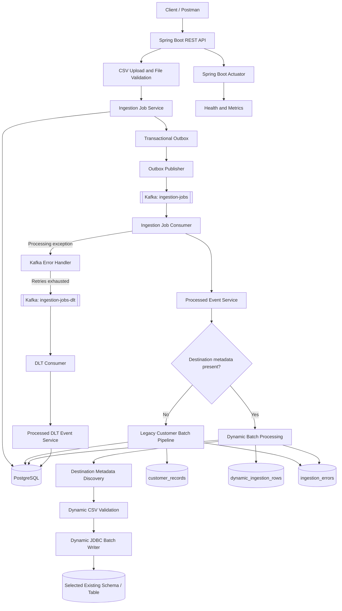
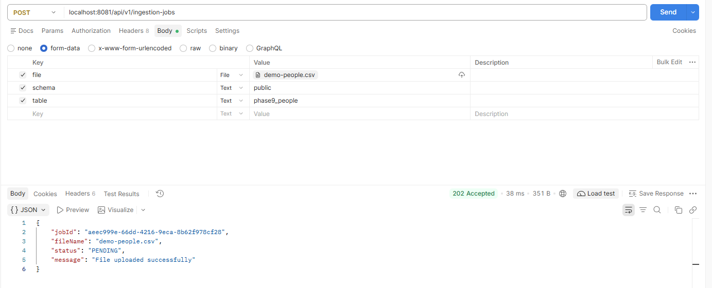
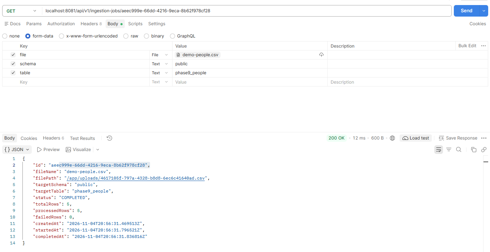
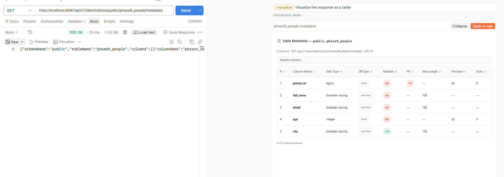
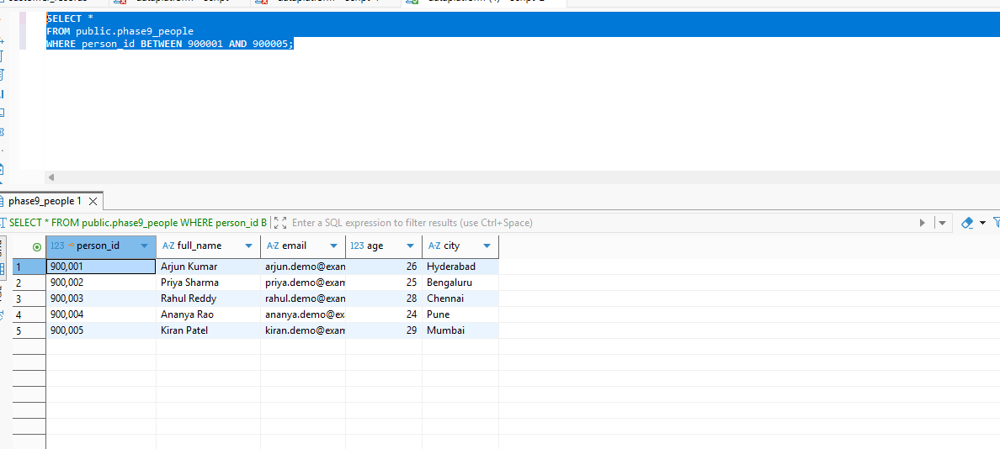

# Distributed Data Ingestion & Processing Platform

A backend platform for **asynchronous, reliable, schema-aware CSV
ingestion** built with Java 25, Spring Boot 4, Apache Kafka, PostgreSQL,
and Docker.

The platform accepts CSV uploads, creates trackable ingestion jobs, and
processes them asynchronously. It supports both a legacy customer-record
workflow and a dynamic workflow that writes CSV data into different
**existing PostgreSQL tables across schemas**.

The system demonstrates practical backend engineering patterns including
the Transactional Outbox, Kafka retry and Dead Letter Topic (DLT)
handling, event and row-level idempotency, safe dynamic SQL, JDBC batch
writes, concurrent outbox claiming, abandoned-event recovery, database
migrations, structured logging, health monitoring, and automated
testing.

------------------------------------------------------------------------

## Project at a glance

| Area | Implementation |
|---|---|
| Application | Java 25, Spring Boot 4 |
| Messaging | Apache Kafka 4.1 |
| Database | PostgreSQL 17 |
| Persistence | Spring Data JPA and JDBC |
| Migrations | Flyway |
| Build | Gradle |
| Local environment | Docker Compose |
| Monitoring | Spring Boot Actuator and Micrometer |
| CI | GitHub Actions |

**Current status:** Phases 1--9 are implemented. Phase 9 (Dynamic
Multi-Table PostgreSQL Ingestion), including final integration and
release-readiness verification, has been completed and merged into
`main`.

## Contents

-   [What the platform does](#what-the-platform-does)
-   [Architecture](#architecture)
-   [Demo](#demo)
-   [How an ingestion job works](#how-an-ingestion-job-works)
-   [Dynamic multi-table ingestion](#dynamic-multi-table-ingestion)
-   [Reliability and failure
    handling](#reliability-and-failure-handling)
-   [Data model](#data-model)
-   [Technology stack](#technology-stack)
-   [Project structure](#project-structure)
-   [Run the application](#run-the-application)
    -   [Setup A: IntelliJ + Docker infrastructure](#setup-a-intellij--docker-infrastructure)
    -   [Setup B: All services in Docker](#setup-b-all-services-in-docker)
    -   [Switch between setups](#switch-between-setups)
    -   [Logs and health checks](#logs-and-health-checks)
-   [API usage](#api-usage)
-   [Testing](#testing)
-   [Observability](#observability)
-   [Continuous integration](#continuous-integration)
-   [Design boundaries and future
    work](#design-boundaries-and-future-work)

------------------------------------------------------------------------

## What the platform does

A client submits a CSV file and, for dynamic ingestion, identifies an
existing destination schema and table. The API creates an ingestion job
and returns a job identifier. Background workers then process the file
through Kafka.

### Core capabilities

-   Multipart CSV upload and file-structure validation.
-   Trackable ingestion jobs with processing status and row counters.
-   Legacy customer-record ingestion with row-level validation and error
    recording.
-   Dynamic ingestion into multiple existing PostgreSQL tables across
    schemas.
-   Runtime discovery of destination-table metadata.
-   CSV header mapping and PostgreSQL data-type validation.
-   Generic JDBC batch insertion with parameterized values.
-   Row-level ingestion ledger for retry-safe dynamic processing.
-   Destination-key conflict detection and rejection.
-   Transactional Outbox for reliable event publication.
-   Kafka consumer idempotency.
-   Exponential-backoff retry handling and Dead Letter Topic processing.
-   Idempotent DLT handling.
-   Concurrent outbox claiming and abandoned-event recovery.
-   Structured JSON logging, correlation information, health endpoints,
    and application metrics.
-   Docker Compose environment and GitHub Actions CI workflow.

------------------------------------------------------------------------

[](https://github.com/codewithsurya27/distributed-data-platform/actions/workflows/ci.yml)


------------------------------------------------------------------------

## Architecture

For a detailed component-level explanation and architecture diagram, see
[System Architecture](docs/architecture/system-architecture.md).

The application separates the synchronous upload request from
asynchronous ingestion processing.



### Component responsibilities

| Component | Responsibility |
|---|---|
| REST controllers | Accept CSV uploads, expose ingestion-job operations, and expose destination metadata |
| Upload validation and storage | Validate the uploaded file and persist it for asynchronous processing |
| Ingestion job service | Create jobs and persist job metadata |
| Transactional Outbox | Persist an event in the same database transaction as the associated job operation |
| Outbox publisher | Claim and publish pending events to Kafka |
| Outbox recovery service | Recover stale outbox events left in `PROCESSING` |
| Kafka consumer | Receive events and route jobs to the legacy or dynamic processing path |
| Processed-event service | Claim and complete event IDs to prevent duplicate processing |
| Destination metadata service | Inspect existing PostgreSQL schemas, tables, columns, types, defaults, identity, and generated-column metadata |
| Dynamic CSV validator | Map CSV headers and validate required fields and supported PostgreSQL data types |
| Dynamic JDBC writer | Insert rows using safely quoted identifiers and parameterized values |
| Dynamic row ledger | Track each dynamic job row as inserted or rejected |
| Kafka error handler | Retry failed processing and forward exhausted messages to the DLT |
| DLT consumer | Record DLT handling idempotently and mark the associated job failed |
| PostgreSQL | Persist jobs, records, errors, events, and processing ledgers |

------------------------------------------------------------------------

## Demo

The screenshots below show the main API and database workflow. They are
stored in `docs/images/` and are rendered directly by GitHub.

### CSV upload

The examples below use the Setup B host port (`8081`). For Setup A, replace `8081` with `8080` in the application URL.



### Ingestion job status



### Destination metadata



### Database results



> The successful demo should show a `COMPLETED` job with zero failed rows.
> The screenshots should correspond to the same successful ingestion run.

---


## How an ingestion job works

### 1. Upload and job creation

1.  The client submits a CSV through the multipart upload endpoint.
2.  The API validates the file structure and stores the uploaded file.
3.  The application creates an ingestion job in PostgreSQL.
4.  A corresponding outbox event is persisted in the same database
    transaction.
5.  The API returns an accepted response with a job ID; processing
    continues asynchronously.

### 2. Outbox publication

1.  `OutboxPublisher` periodically looks for pending events.
2.  `OutboxEventStateService` claims events using PostgreSQL
    `FOR UPDATE SKIP LOCKED`.
3.  Claimed events transition to `PROCESSING`.
4.  The Kafka producer publishes the event to `ingestion-jobs`.
5.  Successfully published events transition to `PUBLISHED`.
6.  Failed publication attempts are recorded and retried up to the
    configured maximum.

The Kafka record key is the job ID.

### 3. Consumer processing

1.  `IngestionJobConsumer` receives the event.
2.  `ProcessedEventService` attempts to claim the event ID.
3.  An event that has already been claimed or completed is ignored.
4.  The consumer selects the processing path:
-   Jobs without destination metadata use the legacy customer-record
    pipeline.
-   Jobs with a destination schema and table use the dynamic
    ingestion pipeline.
5.  The job status and row counters are updated as processing finishes.

### 4. Job status versus outbox status

These are separate lifecycles:

-   An outbox event with status `PUBLISHED` means Kafka accepted the
    event.
-   It does **not** mean that the ingestion job has completed.
-   The ingestion job is completed or failed later by the
    consumer-processing workflow.

------------------------------------------------------------------------

## Dynamic multi-table ingestion

The dynamic workflow evolves the application from a customer-specific
CSV processor into a reusable ingestion platform.

A client can direct an upload to a different **existing** table in any
accessible schema within the PostgreSQL database configured for the
deployment.

### Dynamic processing flow

1.  The upload request supplies `file`, `schema`, and `table`.
2.  The API validates and stores the CSV and persists the destination
    metadata with the job.
3.  The job and outbox event are committed in one database transaction.
4.  The outbox publisher sends the event to Kafka.
5.  The consumer detects destination metadata and routes the job to
    dynamic processing.
6.  The application discovers destination-table metadata from
    PostgreSQL.
7.  CSV headers are normalized and mapped to destination columns.
8.  The validator checks headers, required values, and supported
    PostgreSQL data types.
9.  The JDBC writer inserts valid rows into the selected destination
    table.
10. The row ledger and error records preserve row-level outcomes and
    retry safety.
11. Job status and counters reflect inserted and rejected rows.

### Destination metadata

The metadata service inspects existing destination tables, including:

-   Column names and ordinal positions.
-   PostgreSQL data types.
-   Nullability.
-   Defaults.
-   Primary-key information.
-   Identity-column metadata.
-   Generated-column metadata.

### CSV validation rules

The dynamic validator handles:

-   Unknown headers.
-   Duplicate headers.
-   Missing required headers.
-   Blank values in required columns.
-   Supported PostgreSQL data types.
-   UTF-8 BOM at the beginning of the first header.

A destination column does not need to appear in the CSV when it is
nullable, has a database default, or is an identity/generated column.
PostgreSQL can then apply its default or generation behavior.

A structurally valid CSV can still contain invalid rows. Valid rows can
be persisted while rejected rows are recorded.

### Safe destination writes

-   Destination identifiers are validated and safely quoted.
-   CSV values are bound as SQL parameters.
-   Request data is not treated as executable SQL.
-   Destination tables and schemas are not automatically created or
    altered.

### Row-level outcome ledger

The `dynamic_ingestion_rows` table records each dynamic job row using
the `(job_id, row_number)` key.

| Outcome | Meaning |
|---|---|
| `INSERTED` | The row was inserted into the selected destination table |
| `REJECTED` | The row was rejected by validation or destination-key conflict handling |

The ledger makes row processing retry-safe by preserving committed row
outcomes. Destination-key conflicts are recorded as
`DUPLICATE_DESTINATION_KEY`; the conflicting insert does not modify the
destination row.

------------------------------------------------------------------------

## Reliability and failure handling

### Transactional Outbox

The ingestion job and its corresponding outbox event are persisted in
the same database transaction. This avoids relying on a separate
database write and Kafka publish both succeeding as one operation.

### Main consumer idempotency

The `processed_events` table tracks event IDs. PostgreSQL
`ON CONFLICT DO NOTHING` prevents the same event ID from being claimed
twice.

### Concurrent outbox publishing

The outbox claiming query uses `FOR UPDATE SKIP LOCKED` so concurrent
publisher workers do not select the same locked rows.

### Abandoned-event recovery

`OutboxRecoveryService` identifies events that remain in `PROCESSING`
beyond the configured timeout and returns them to `PENDING`.

### Outbox retry limits

Failed publication attempts are recorded. Events transition to `FAILED`
after reaching the configured maximum attempt count.

### Kafka retry and DLT

The Kafka listener uses retry handling with exponential backoff.
Messages that exhaust the configured retry policy are routed to
`ingestion-jobs-dlt`.

The DLT consumer uses `processed_dlt_events` to ensure repeated DLT
deliveries do not repeat the job-failure operation.

**Delivery semantics:** These mechanisms provide retry and idempotency
safeguards. They do not imply that every operation in the distributed
workflow is exactly-once.

------------------------------------------------------------------------

## Data model

Flyway manages database schema migrations.

### Main tables

| Table | Purpose |
|---|---|
| `ingestion_jobs` | Job metadata, status, counters, destination, and file information |
| `customer_records` | Successfully validated records from the legacy customer workflow |
| `ingestion_errors` | Row-level validation and duplicate-record errors |
| `outbox_events` | Events waiting to be published or already published/failed |
| `processed_events` | Main Kafka event-processing markers |
| `processed_dlt_events` | DLT event-handling markers |
| `dynamic_ingestion_rows` | Per-job, per-row outcomes for retry-safe dynamic ingestion |

### Migration history

| Migration | Purpose |
|---|---|
| V1--V7 | Initial job, customer, error, outbox, and processed-event schema evolution |
| V8 | Create processed DLT events |
| V9 | Add target schema and target table to ingestion jobs |
| V10 | Create the dynamic ingestion row-outcome ledger |

### Outbox statuses

| Status | Meaning |
|---|---|
| `PENDING` | Ready to be claimed |
| `PROCESSING` | Claimed by a publisher |
| `PUBLISHED` | Kafka accepted the event |
| `FAILED` | Maximum publication attempts reached |

------------------------------------------------------------------------

## Technology stack

| Technology | Usage |
|---|---|
| Java 25 | Application language and runtime |
| Spring Boot 4.0.9 | Application framework |
| Spring Web MVC | REST APIs and multipart uploads |
| Spring Data JPA / Hibernate | Job and application persistence |
| JDBC | Generic dynamic destination-table writes |
| Spring Kafka | Kafka integration |
| Apache Kafka 4.1.x | Asynchronous event transport |
| PostgreSQL 17 | Relational database |
| Flyway | Database migrations |
| Apache Commons CSV | CSV parsing |
| Gradle | Build and dependency management |
| Docker | Application containerization |
| Docker Compose | Local multi-container orchestration |
| Spring Boot Actuator | Health and metrics |
| Micrometer | Application metrics |
| JUnit 5 / Mockito | Automated testing |
| Testcontainers | Container-based integration testing |
| GitHub Actions | Continuous integration |

------------------------------------------------------------------------

## Project structure

Main application package: `com.surya.DistributedDataPlatform`

``` text
distributed-data-platform/
├── .github/
│   └── workflows/
│       └── ci.yml
├── gradle/
│   └── wrapper/
├── scripts/
│   └── phase9/
├── src/
│   ├── main/
│   │   ├── java/com/surya/DistributedDataPlatform/
│   │   │   ├── common/
│   │   │   ├── config/
│   │   │   ├── jobs/
│   │   │   ├── messaging/
│   │   │   │   ├── consumer/
│   │   │   │   ├── error/
│   │   │   │   ├── event/
│   │   │   │   ├── producer/
│   │   │   │   └── outbox/
│   │   │   └── processing/
│   │   │       ├── dynamic/
│   │   │       ├── parser/
│   │   │       ├── service/
│   │   │       └── validator/
│   │   └── resources/
│   │       ├── application.properties
│   │       └── db/migration/
│   └── test/
│       └── java/com/surya/DistributedDataPlatform/
├── .dockerignore
├── .env.example
├── Dockerfile
├── compose.yml
├── build.gradle
├── gradlew
└── README.md
```

The tree highlights the principal components. Refer to the source tree
for all DTOs, entities, repositories, controllers, and tests.

------------------------------------------------------------------------

## Run the application

The project supports two execution modes. Use **Setup A** for everyday
development and IntelliJ debugging. Use **Setup B** to run the complete
application stack in Docker.

### Prerequisites

- Git
- Docker Desktop with Docker Compose
- Java 25 JDK
- PowerShell (for the provided Windows commands)

### Environment configuration

Clone the repository:

```powershell
git clone https://github.com/codewithsurya27/distributed-data-platform.git
cd distributed-data-platform
```

Optionally create your local environment file:

```powershell
Copy-Item .env.example .env
```

Update `.env` if you want different local database credentials. The `.env`
file is excluded from Git; do not commit real credentials.

### Setup A: IntelliJ + Docker infrastructure

**Recommended for development, breakpoints, and debugging.**

In this mode, PostgreSQL and Kafka run in Docker, while Spring Boot runs
directly on your machine from IntelliJ.

#### 1. Start PostgreSQL and Kafka

```powershell
docker compose -f compose.yml up -d postgres kafka
```

Check their status:

```powershell
docker compose -f compose.yml ps
```

Wait until PostgreSQL and Kafka report healthy.

#### 2. Run Spring Boot from IntelliJ

1. Open the project in IntelliJ IDEA.
2. Open `DistributedDataPlatformApplication.java`.
3. Open **Run → Edit Configurations** and select the Spring Boot run
   configuration.
4. Leave **Active profiles** empty. Do not activate the `docker` profile.
5. Click **Debug** to use breakpoints, or **Run** for normal execution.

The default `application.properties` connects to the Docker-hosted services
through their published host ports:

```properties
spring.datasource.url=jdbc:postgresql://localhost:5433/dataplatform
spring.kafka.bootstrap-servers=localhost:9093
```

The application is available at `http://localhost:8080`.

#### 3. Run the application from PowerShell (optional)

Instead of IntelliJ, you can start the local application with:

```powershell
.\gradlew.bat bootRun
```

Keep the default Spring profile active so it uses `localhost:5433` and
`localhost:9093`.

### Setup B: All services in Docker

Use this mode to run the Spring Boot application, PostgreSQL, and Kafka
together through Docker Compose.

The Docker image uses the executable JAR built on the host machine. This
keeps Gradle distribution downloads out of the Docker image build.

#### 1. Build and start with one command

Create `start-docker.ps1` in the repository root with the following contents:

```powershell
$ErrorActionPreference = "Stop"

Write-Host "`n[1/3] Building Spring Boot application..." -ForegroundColor Cyan
.\gradlew.bat clean bootJar -x test
if ($LASTEXITCODE -ne 0) { throw "Gradle build failed. Docker deployment cancelled." }

Write-Host "`n[2/3] Building and starting Docker services..." -ForegroundColor Cyan
docker compose -f compose.yml up -d --build
if ($LASTEXITCODE -ne 0) { throw "Docker Compose failed." }

Write-Host "`n[3/3] Checking container status..." -ForegroundColor Cyan
docker compose -f compose.yml ps

Write-Host "`nApplication deployment completed." -ForegroundColor Green
Write-Host "Application URL: http://localhost:8081"
```

Then run the script from the repository root:

```powershell
.\start-docker.ps1
```

The script:
1. Runs `.\gradlew.bat clean bootJar -x test` on the host.
2. Stops and cancels deployment if the Gradle build fails.
3. Builds the Docker image and starts all Compose services.
4. Displays the service status.

If you prefer to run the steps separately:

```powershell
.\gradlew.bat clean bootJar -x test
docker compose -f compose.yml up -d --build
```

**Important:** When building the Docker image directly, build the JAR first.
The Dockerfile copies the JAR from `build/libs/`; it does not run Gradle
inside the image build.

#### 2. Check service status

```powershell
docker compose -f compose.yml ps
```

The application should be available at `http://localhost:8081`.

Inside the Compose network, the application connects to PostgreSQL using
`postgres:5432` and Kafka using `kafka:29092`.

### Switch between setups

Stop the application in the current runtime before starting it in the other
runtime. Do not run both Spring Boot instances at the same time: they use the
same Kafka consumer group and can process messages concurrently.

**Switch from full Docker to IntelliJ:**

```powershell
docker compose -f compose.yml stop app
docker compose -f compose.yml up -d postgres kafka
```

Then run or debug `DistributedDataPlatformApplication` in IntelliJ with the
default profile (no active `docker` profile).

**Switch from IntelliJ to full Docker:**

1. Stop the Spring Boot application using IntelliJ's Stop button.
2. Run:

```powershell
.\start-docker.ps1
```

**Stop all Docker services:**

```powershell
docker compose -f compose.yml stop
```

This stops the containers but preserves named volumes and their data.

To stop and remove containers and the Compose network while retaining
named volumes:

```powershell
docker compose -f compose.yml down
```

**Warning:** The following command also deletes the named PostgreSQL and
Kafka volumes and their stored data. Use it only when you intentionally
want to reset the local environment:

```powershell
docker compose -f compose.yml down -v
```

### Logs and health checks

**Follow Spring Boot logs in full-Docker mode:**

```powershell
docker compose -f compose.yml logs -f app
```

**Follow logs from all services:**

```powershell
docker compose -f compose.yml logs -f
```

**Follow only PostgreSQL and Kafka logs in Setup A:**

```powershell
docker compose -f compose.yml logs -f postgres kafka
```

In Setup A, application logs appear in the IntelliJ Run/Debug console.
In Setup B, application logs appear in Docker Desktop's app container
**Logs** tab or through the Docker Compose commands above.

Health endpoints:

| Mode | Overall health URL |
|---|---|
| Setup A (IntelliJ) | `http://localhost:8080/actuator/health` |
| Setup B (Docker) | `http://localhost:8081/actuator/health` |

Other Actuator endpoints use the same host and port with these paths:

- `/actuator/health/db`
- `/actuator/health/kafka`
- `/actuator/health/liveness`
- `/actuator/health/readiness`
- `/actuator/metrics`

### Service ports

| Service | Setup A: host connection | Setup B: host connection | Docker internal address |
|---|---:|---:|---|
| Spring Boot application | 8080 | 8081 | `app:8080` |
| PostgreSQL | 5433 | 5433 | `postgres:5432` |
| Kafka | 9093 | 9093 | `kafka:29092` |

The Spring profile is the default profile in Setup A and `docker` in Setup B.
The Docker Compose `app` service sets `SPRING_PROFILES_ACTIVE=docker`.

---

## API usage

The application exposes CSV upload, ingestion-job, and destination
metadata APIs.

### CSV upload

The examples below use the Setup B host port (`8081`). For Setup A, replace `8081` with `8080` in the application URL.

``` http
POST http://localhost:8081/api/v1/ingestion-jobs
Content-Type: multipart/form-data
```

Required multipart field:

| Field | Type | Description |
|---|---|---|
| `file` | File | CSV file to ingest |

For a dynamic ingestion job, also provide:

| Field | Type | Description |
|---|---|---|
| `schema` | Text | Existing PostgreSQL destination schema |
| `table` | Text | Existing PostgreSQL destination table |

Example using PowerShell and `curl.exe`:

``` powershell
curl.exe -X POST "http://localhost:8081/api/v1/ingestion-jobs" `
  -F "file=@scripts/phase9/people.csv" `
  -F "schema=public" `
  -F "table=phase9_people"
```

A successful upload returns `202 Accepted` with a `jobId`, file name,
initial status, and message.
Use the returned job ID to retrieve the ingestion status:

GET http://localhost:8081/api/v1/ingestion-jobs/{jobId}

To list ingestion jobs:

GET http://localhost:8081/api/v1/ingestion-jobs

### Destination metadata discovery

Retrieve metadata for an existing destination table:

``` http
GET http://localhost:8081/api/v1/destinations/{schema}/{table}/metadata
```

Example:

``` text
http://localhost:8081/api/v1/destinations/public/phase9_people/metadata
```

The response describes destination columns, including database types,
nullability, defaults, primary-key information, identity metadata,
generated-column metadata, and ordinal position.

### Useful PostgreSQL queries

Recent ingestion jobs:

``` sql
SELECT
    id,
    status,
    total_rows,
    processed_rows,
    failed_rows,
    target_schema,
    target_table,
    completed_at
FROM ingestion_jobs
ORDER BY created_at DESC
LIMIT 10;
```

Dynamic row outcomes:

``` sql
SELECT
    job_id,
    row_number,
    target_schema,
    target_table,
    outcome,
    created_at
FROM dynamic_ingestion_rows
ORDER BY created_at DESC
LIMIT 20;
```

Outbox events:

``` sql
SELECT
    id,
    job_id,
    event_type,
    status,
    attempts,
    last_error,
    published_at
FROM outbox_events
ORDER BY created_at DESC
LIMIT 10;
```

Main consumer idempotency:

``` sql
SELECT
    event_id,
    job_id,
    status,
    received_at,
    completed_at
FROM processed_events
ORDER BY received_at DESC
LIMIT 10;
```

DLT idempotency:

``` sql
SELECT
    event_id,
    job_id,
    handled_at
FROM processed_dlt_events
ORDER BY handled_at DESC
LIMIT 10;
```

Legacy customer records:

``` sql
SELECT *
FROM customer_records
ORDER BY created_at DESC
LIMIT 10;
```

Row-level errors:

``` sql
SELECT *
FROM ingestion_errors
ORDER BY id DESC
LIMIT 10;
```

------------------------------------------------------------------------

## Testing

Run the full test suite:

``` powershell
.\gradlew.bat clean test
```

The project includes tests covering:

-   Application context and API behavior.
-   Kafka consumer idempotency.
-   DLT idempotency.
-   Outbox state transitions, retry limits, and recovery.
-   Legacy and dynamic batch-processing paths.
-   Dynamic CSV header and PostgreSQL type validation.
-   UTF-8 BOM handling in the first CSV header.
-   Generic JDBC writer behavior and destination-key conflicts.
-   Dynamic row-ledger and retry-safety behavior.
-   PostgreSQL integration behavior, including rollback, duplicate
    handling, multiple schemas/tables, and safe identifiers.
-   Customer validation.

Testcontainers is used for container-based integration testing.

The full test suite was reported as successful during final integration
verification. Run the command above against your current checkout to
obtain the latest result.

------------------------------------------------------------------------

## Observability

### Structured logging

-   Logstash-compatible structured JSON console logs.
-   Request logging through `RequestLoggingFilter`.
-   Correlation information through MDC.
-   Job and event identifiers in processing logs where available.
-   Batch-processing and outbox lifecycle logging.

### Actuator health endpoints

| Endpoint | Purpose |
|---|---|
| `/actuator/health` | Overall application health |
| `/actuator/health/db` | PostgreSQL health |
| `/actuator/health/kafka` | Custom Kafka connectivity check |
| `/actuator/health/liveness` | Application liveness |
| `/actuator/health/readiness` | Application readiness |

Use port `8080` in Setup A (IntelliJ) or `8081` in Setup B (Docker):

``` text
http://localhost:8081/actuator/health
http://localhost:8081/actuator/health/kafka
http://localhost:8081/actuator/health/liveness
http://localhost:8081/actuator/health/readiness
```

### Custom application metrics

| Metric | Description |
|---|---|
| `ingestion.jobs.created` | Number of ingestion jobs created |
| `ingestion.jobs.completed` | Number of completed jobs, including `COMPLETED_WITH_ERRORS` |
| `ingestion.jobs.failed` | Number of jobs marked failed through DLT handling |
| `ingestion.records.processed` | Number of valid records persisted |
| `ingestion.records.rejected` | Number of rejected records persisted |
| `ingestion.job.duration` | Ingestion job processing duration |

Metrics are exposed through:

``` text
http://localhost:8081/actuator/metrics
```

A specific metric can be inspected using:

``` text
http://localhost:8081/actuator/metrics/ingestion.jobs.created
```

------------------------------------------------------------------------

## Continuous integration

GitHub Actions workflow:

``` text
.github/workflows/ci.yml
```

The workflow runs on pushes to `main` and
`feature/docker-ci-deployment`, pull requests targeting `main`, and
manual workflow dispatch.

The CI workflow:

1.  Checks out the repository.
2.  Sets up Java 25.
3.  Sets up Gradle.
4.  Starts a PostgreSQL 17 service container.
5.  Executes the Gradle test suite.
6.  Builds the Docker image.

Because the local Dockerfile packages a host-built JAR, the CI workflow
must run the Gradle `bootJar` task before its Docker image build. Keep that
step in sync with the Dockerfile whenever the container build strategy
changes. The local `start-docker.ps1` script performs this sequence on
Windows.

Check the **Actions** tab in the GitHub repository for workflow
execution results.

------------------------------------------------------------------------

## Design boundaries and future work

### Current boundaries

-   **Database connection:** One PostgreSQL database connection is
    configured per deployment.
-   **Destinations:** Multiple existing schemas and tables within that
    configured database.
-   **Per-upload destination:** Schema and table are request-level
    fields persisted on the ingestion job.
-   **Credentials and connectivity:** Database URL, credentials, and
    connection settings remain deployment configuration; clients cannot
    supply JDBC URLs or credentials.
-   **Schema management:** The initial dynamic ingestion implementation
    does not create or alter destination tables or schemas.
-   **Supported data types:** Only PostgreSQL types supported by the
    dynamic validator and JDBC writer are accepted.
-   **Delivery semantics:** Retry and idempotency safeguards are
    implemented; the overall distributed workflow is not claimed to
    provide exactly-once execution.

### Potential future extensions

-   Streaming validation and processing for very large CSV files.
-   Configurable source-to-destination column mapping.
-   Additional database engines.
-   Multiple database connections and destination connection profiles.
-   Schema-evolution and destination-table provisioning workflows.
-   Expanded operational dashboards and alerting.

**Design principle:** Database connectivity is deployment configuration;
ingestion destination selection is request-level job metadata.

------------------------------------------------------------------------

## Repository

**GitHub:** https://github.com/codewithsurya27/distributed-data-platform

The source code, application configuration, and Flyway migrations are
the source of truth for exact implementation details.
