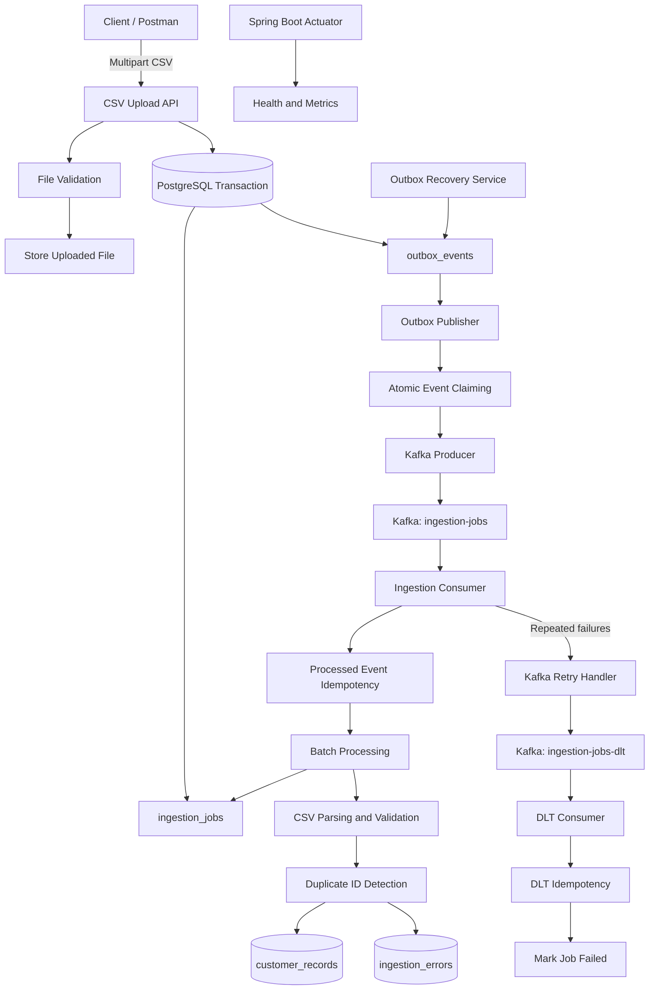

Distributed Data Ingestion & Processing Platform
A distributed CSV ingestion backend built with Java 25, Spring Boot 4, PostgreSQL, Apache Kafka, and Gradle.

The platform accepts CSV uploads, creates trackable ingestion jobs, validates and processes customer records asynchronously in batches, and uses Kafka for reliable event-driven processing.

It implements the Transactional Outbox pattern, Kafka retries and Dead Letter Topic (DLT) handling, consumer idempotency, duplicate customer-ID protection, concurrent outbox claiming, abandoned-event recovery, structured logging, application health monitoring, and automated tests.

The project also includes Docker Compose orchestration and a GitHub Actions CI workflow.

Project status: Phases 1–8 completed. Phase 9 — Dynamic Multi-Table PostgreSQL Ingestion — is in development.
Contents
1. Overview
2. Architecture
3. End-to-end workflow
4. Reliability and failure handling
5. Database model
6. Technology stack
7. Project structure
8. Configuration
9. Run with Docker Compose
10. Run locally without Docker
11. API and verification
12. Automated tests
13. Observability and monitoring
14. CI pipeline
15. Implementation roadmap
16. Upcoming: Dynamic Multi-Table PostgreSQL Ingestion
1. Overview
   The platform separates synchronous file uploads from background data processing.

When a client uploads a CSV:
1. The API validates the file structure.
2. The application stores the uploaded file.
3. An ingestion job is created in PostgreSQL.
4. A corresponding outbox event is persisted in the same database transaction.
5. A scheduled publisher sends the event to Kafka.
6. A Kafka consumer processes the CSV asynchronously.
7. The job status and processing counters are updated.
   Core capabilities
- Multipart CSV upload and structural validation.
- Ingestion job creation and status tracking.
- Row-level customer validation and error recording.
- Batch persistence to PostgreSQL.
- Asynchronous processing using Apache Kafka.
- Transactional Outbox for reliable event publication.
- Kafka retries with exponential backoff and DLT handling.
- Main consumer idempotency.
- Duplicate customer-ID detection.
- Atomic outbox event claiming using PostgreSQL locking.
- Recovery of abandoned outbox events.
- Configurable retry limits.
- Idempotent DLT event handling.
- Structured JSON logging and correlation IDs.
- Spring Boot Actuator health endpoints.
- Custom ingestion metrics.
- Docker Compose deployment.
- GitHub Actions continuous integration.
- Automated unit and integration tests.
2. Architecture

Component responsibilities
Component	Responsibility
REST controllers	Accept uploads and expose ingestion-job operations
CSV validation	Validate file structure and required headers
PostgreSQL	Persist jobs, customer records, errors, and events
Transactional Outbox	Persist events with associated database operations
Outbox publisher	Claim and publish pending events
Kafka producer	Publish ingestion events
Kafka consumer	Trigger asynchronous processing
Batch processor	Parse, validate, and persist records in batches
Processed-event service	Prevent duplicate event processing
Kafka error handler	Retry failed processing and forward exhausted messages to DLT
DLT consumer	Record DLT handling and mark associated jobs failed
Outbox recovery service	Recover stale PROCESSING events

3. End-to-end workflow
   3.1 Upload and job creation
1. The client submits a CSV through the multipart upload endpoint.
2. The controller coordinates validation and file storage.
3. File-level validation checks the CSV structure and required headers.
4. The application creates an ingestion job.
5. An outbox event is created in the same database transaction.
6. The API responds without waiting for background processing to finish.
   3.2 Outbox publication
1. OutboxPublisher periodically looks for pending events.
2. OutboxEventStateService claims events using PostgreSQL FOR UPDATE SKIP LOCKED.
3. Claimed events transition to PROCESSING.
4. The Kafka producer publishes an event to ingestion-jobs.
5. Successfully published events transition to PUBLISHED.
6. Failed attempts are recorded and retried until the configured maximum is reached.
   The Kafka record key is the job ID.
   3.3 Background processing
1. IngestionJobConsumer receives the event.
2. ProcessedEventService attempts to claim the event ID.
3. Previously processed event IDs are ignored.
4. New events trigger batch processing.
5. CSV rows are parsed and validated.
6. Duplicate customer IDs within the CSV are detected.
7. Valid records and row-level errors are persisted in batches.
8. The job is finalized with its resulting status and row counters.
   3.4 Validation
   File-level validation checks whether the CSV has the expected structure and headers.

Row-level validation checks individual customer values after the file is accepted.

A structurally valid CSV can still contain invalid rows. Valid records can be persisted while rejected rows are recorded in ingestion_errors.

For duplicate customer IDs, the first valid occurrence is retained and subsequent occurrences are recorded as DUPLICATE_CUSTOMER_ID.
3.5 Job and outbox lifecycles
The job status and outbox status represent separate lifecycles.

An outbox event reaching PUBLISHED means Kafka accepted the event. It does not mean that the ingestion job has completed.
4. Reliability and failure handling
   Transactional Outbox
   The job and its corresponding outbox event are persisted in the same database transaction. This avoids relying on separate database and Kafka operations succeeding independently.
   Main consumer idempotency
   The processed_events table tracks event IDs. PostgreSQL ON CONFLICT DO NOTHING prevents the same event ID from being claimed twice.
   Concurrent outbox publishing
   The outbox claiming query uses FOR UPDATE SKIP LOCKED to prevent concurrent publisher workers from selecting the same locked rows.
   Abandoned-event recovery
   OutboxRecoveryService identifies events that remain in PROCESSING beyond the configured timeout and returns them to PENDING.
   Outbox retry limits
   Failed publication attempts are recorded. Events become FAILED after reaching the configured maximum attempt count.
   Kafka retry and DLT
   The Kafka listener uses retry handling with exponential backoff. Messages that exhaust the configured retry policy are routed to ingestion-jobs-dlt.

The DLT consumer uses processed_dlt_events to ensure repeated DLT deliveries do not repeat the job failure operation.

Delivery semantics: These mechanisms provide retry and idempotency safeguards. They do not imply that every operation in the distributed workflow is exactly-once.
5. Database model
   Flyway manages database schema migrations.
   Migration	Purpose
   V1	Create ingestion jobs
   V2	Allow metadata-only jobs
   V3	Create customer records and ingestion errors
   V4	Create outbox events
   V5	Align outbox schema
   V6	Create processed events
   V7	Add outbox processing timestamp
   V8	Create processed DLT events

Main tables
Table	Purpose
ingestion_jobs	Job metadata, status, counters, and file information
customer_records	Successfully validated customer records
ingestion_errors	Row-level validation and duplicate-record errors
outbox_events	Events waiting to be published or already published/failed
processed_events	Main Kafka event processing markers
processed_dlt_events	DLT event handling markers

Outbox statuses
Status	Meaning
PENDING	Ready to be claimed
PROCESSING	Claimed by a publisher
PUBLISHED	Kafka accepted the event
FAILED	Maximum publishing attempts reached

6. Technology stack
   Technology	Usage
   Java 25	Application language and runtime
   Spring Boot 4.0.9	Application framework
   Spring Web MVC	REST APIs and multipart uploads
   Spring Data JPA / Hibernate	Persistence
   Spring Kafka	Kafka integration
   Apache Kafka 4.1.x	Asynchronous event transport
   PostgreSQL 17	Relational database
   Flyway	Database migrations
   Apache Commons CSV	CSV parsing
   Gradle	Build and dependency management
   Docker	Application containerization
   Docker Compose	Local multi-container orchestration
   Spring Boot Actuator	Health and metrics
   Micrometer	Application metrics
   JUnit 5 / Mockito	Automated testing
   Testcontainers	Container-based integration testing
   GitHub Actions	Continuous integration

7. Project structure
   Main application package:

com.surya.DistributedDataPlatform
distributed-data-platform/
├── .github/
│   └── workflows/
│       └── ci.yml
├── gradle/
│   └── wrapper/
├── src/
│   ├── main/
│   │   ├── java/com/surya/DistributedDataPlatform/
│   │   │   ├── common/
│   │   │   ├── config/
│   │   │   ├── jobs/
│   │   │   ├── messaging/
│   │   │   │   ├── consumer/
│   │   │   │   ├── error/
│   │   │   │   ├── event/
│   │   │   │   ├── producer/
│   │   │   │   └── outbox/
│   │   │   └── processing/
│   │   │       ├── parser/
│   │   │       ├── service/
│   │   │       └── validator/
│   │   └── resources/
│   │       ├── application.properties
│   │       └── db/migration/
│   └── test/
│       └── java/com/surya/DistributedDataPlatform/
├── .dockerignore
├── .env.example
├── Dockerfile
├── compose.yml
├── build.gradle
├── gradlew
└── README.md
The tree highlights the principal components. Refer to the source tree for all DTOs, entities, repositories, controllers, and tests.
8. Configuration
   Environment variables
   The Docker Compose configuration supports the following variables:
   Variable	Default	Purpose
   POSTGRES_DB	dataplatform	Database name
   POSTGRES_USER	dataplatform	Database username
   POSTGRES_PASSWORD	devpassword	Local development password

The .env.example file contains the development defaults.

Create your local environment file:
Copy-Item .env.example .env
The .env file is excluded from Git. Do not commit real credentials.
Important application properties
Property	Purpose
spring.datasource.url	PostgreSQL connection
spring.kafka.bootstrap-servers	Kafka broker connection
app.upload-dir	Uploaded file storage directory
app.processing.batch-size	Number of records processed per batch
app.outbox.batch-size	Number of outbox events claimed per batch
app.outbox.max-attempts	Maximum outbox publication attempts
app.outbox.recovery-timeout-seconds	Timeout for abandoned events

Refer to src/main/resources/application.properties for the complete configuration.
9. Run with Docker Compose
   Prerequisites
- Git
- Docker Desktop
- Docker Compose
  Step 1: Clone the repository
  git clone https://github.com/codewithsurya27/distributed-data-platform.git
  cd distributed-data-platform
  Step 2: Configure environment
  Copy-Item .env.example .env
  Update .env if you want to use different local database credentials.
  Step 3: Build and start services
  docker compose -f compose.yml up --build -d
  This starts:
- Spring Boot application
- PostgreSQL
- Apache Kafka
  The application image uses a multi-stage Docker build. Gradle builds the executable JAR in the build stage, while the runtime stage uses a Java 25 JRE image and runs as a non-root user.
  Step 4: Check container health
  docker compose -f compose.yml ps
  View application logs:
  docker compose -f compose.yml logs --tail=100 app
  Follow application logs:
  docker compose -f compose.yml logs -f app
  Docker service ports
  Service	Host port	Container port
  Spring Boot application	8081	8080
  PostgreSQL	5433	5432
  Kafka	9093	9092

Inside the Compose network, the application connects to PostgreSQL using postgres:5432 and Kafka using kafka:29092.
Step 5: Stop services
docker compose -f compose.yml down
This stops and removes the containers and network but retains named volumes.

To remove persistent database and Kafka data as well, Docker Compose supports:
docker compose -f compose.yml down -v
Warning: This deletes the named volumes and their stored data. Only use it when you intentionally want to reset the local environment.
10. Run locally without Docker
    For standalone application development, Java 25 and locally accessible PostgreSQL and Kafka instances are required.

Configure the local datasource and Kafka bootstrap server in application.properties or through environment variables.

Typical local endpoints:
PostgreSQL: localhost:5432
Kafka:      localhost:9092
Run the application:
.\gradlew.bat bootRun
Run tests:
.\gradlew.bat clean test
Open the Gradle test report:
Start-Process .\build\reports\tests\test\index.html
11. API and verification
    The application exposes CSV upload and ingestion-job APIs.

The CSV upload endpoint verified during Docker testing:
POST http://localhost:8081/api/v1/ingestion-jobs
Request format:
- Content-Type: multipart/form-data
- Form field: file
- Value: CSV file
  A successful upload returns 202 Accepted with a job identifier and initial job status.

Refer to the current CsvUploadController and IngestionJobController source for the complete endpoint mappings, request fields, and response DTOs.
Useful PostgreSQL queries
Recent ingestion jobs:
SELECT
id,
status,
total_rows,
processed_rows,
failed_rows,
completed_at
FROM ingestion_jobs
ORDER BY created_at DESC
LIMIT 10;
Outbox events:
SELECT
id,
job_id,
event_type,
status,
attempts,
last_error,
published_at
FROM outbox_events
ORDER BY created_at DESC
LIMIT 10;
Main consumer idempotency:
SELECT
event_id,
job_id,
status,
received_at,
completed_at
FROM processed_events
ORDER BY received_at DESC
LIMIT 10;
DLT idempotency:
SELECT
event_id,
job_id,
handled_at
FROM processed_dlt_events
ORDER BY handled_at DESC
LIMIT 10;
Customer records:
SELECT *
FROM customer_records
ORDER BY created_at DESC
LIMIT 10;
Row-level errors:
SELECT *
FROM ingestion_errors
LIMIT 10;
Docker-based verification
The complete Docker-based ingestion flow was manually verified:
1. CSV uploaded successfully.
2. API returned 202 Accepted.
3. Job transitioned from PENDING to COMPLETED.
4. Valid records were persisted.
5. Outbox event transitioned to PUBLISHED.
6. Kafka consumer processed the event.
7. Processed-event marker was recorded.
12. Automated tests
    Run the full suite:
    .\gradlew.bat clean test
    The project includes:
- Application context tests.
- API integration tests.
- Kafka consumer idempotency tests.
- DLT idempotency tests.
- Outbox state and retry tests.
- Outbox recovery tests.
- Batch processing tests.
- Customer validation tests.
  The previously reported full test run completed with 26 tests, 0 failures, and 0 skipped. A subsequent test run after the integration-test context cleanup change also completed successfully.

Testcontainers is used for container-based integration testing.
13. Observability and monitoring
    Structured logging
- Logstash-compatible structured JSON console logs.
- Request logging through RequestLoggingFilter.
- Correlation information through MDC.
- Job and event identifiers in processing logs where available.
- Batch processing and outbox lifecycle logging.
  Actuator health endpoints
  Endpoint	Purpose
  /actuator/health	Overall application health
  /actuator/health/db	PostgreSQL health
  /actuator/health/kafka	Custom Kafka connectivity check
  /actuator/health/liveness	Application liveness
  /actuator/health/readiness	Application readiness

For the Docker deployment, use port 8081:
http://localhost:8081/actuator/health
http://localhost:8081/actuator/health/kafka
http://localhost:8081/actuator/health/liveness
http://localhost:8081/actuator/health/readiness
Custom application metrics
Metric	Description
ingestion.jobs.created	Number of ingestion jobs created
ingestion.jobs.completed	Number of completed jobs, including COMPLETED_WITH_ERRORS
ingestion.jobs.failed	Number of jobs marked failed through DLT handling
ingestion.records.processed	Number of valid records persisted
ingestion.records.rejected	Number of rejected records persisted
ingestion.job.duration	Ingestion job processing duration

Metrics are exposed through:
http://localhost:8081/actuator/metrics
A specific metric can be inspected using:
http://localhost:8081/actuator/metrics/ingestion.jobs.created
14. CI pipeline
    GitHub Actions workflow:
    .github/workflows/ci.yml
    The workflow runs on pushes to main and feature/docker-ci-deployment, pull requests targeting main, and manual workflow dispatch.
    CI steps
1. Check out the repository.
2. Set up Java 25.
3. Set up Gradle.
4. Start a PostgreSQL 17 service container.
5. Execute the Gradle test suite.
6. Build the Docker image.
   The Docker build uses the multi-stage Dockerfile, so the workflow does not depend on a prebuilt JAR from the developer's machine.

Check the Actions tab in the GitHub repository for workflow execution results.
15. Implementation roadmap
16. Upcoming: Dynamic Multi-Table PostgreSQL Ingestion
    Phase	Scope	Status
    Phase 1	Job metadata API	Complete
    Phase 2	CSV upload and structural validation	Complete
    Phase 3	Asynchronous batch processing	Complete
    Phase 4	Kafka integration, Transactional Outbox, retries, and DLT	Complete
    Phase 5	Idempotency, duplicate protection, concurrency, recovery, retry limits, and automated tests	Complete
    Phase 6	Structured logging, health checks, and application metrics	Complete
    Phase 7	Docker, Compose orchestration, environment configuration, and GitHub Actions CI	Complete; locally verified
    Phase 8	Final documentation and operational improvements	Complete
    Phase 9	Dynamic multi-table PostgreSQL ingestion	In progress

16. Upcoming: Dynamic Multi-Table PostgreSQL Ingestion
    The next development phase will evolve the platform from a customer-specific CSV processor into a reusable ingestion platform that can load different CSV files into different existing PostgreSQL tables.
    Goals
- Support multiple PostgreSQL schemas and existing tables within the configured database.
- Allow each upload request to specify its destination schema and table.
- Store the destination against the ingestion job so asynchronous Kafka processing uses the correct target.
- Discover destination table columns and PostgreSQL data types at runtime.
- Map CSV headers to destination columns and validate incoming values.
- Insert records using a generic JDBC batch-writing mechanism rather than a hardcoded customer-table writer.
- Preserve the existing Kafka, Transactional Outbox, retry, Dead Letter Topic (DLT), and idempotency mechanisms.
- Support different upload destinations without changing deployment configuration or restarting the application.
  Planned implementation
1. Add destination schema and table metadata to ingestion jobs.
2. Extend the upload API to accept destination details with the CSV file.
3. Validate the requested destination and discover PostgreSQL table metadata.
4. Implement CSV-header-to-column mapping and data-type validation.
5. Implement generic JDBC batch insertion.
6. Integrate dynamic writing with asynchronous Kafka processing and existing reliability mechanisms.
7. Add unit and integration tests covering multiple schemas and tables.
8. Verify the complete workflow with Docker Compose and update operational documentation.
   Initial scope and design boundaries
- One PostgreSQL database connection is configured per deployment.
- Multiple schemas and existing tables in that database can be ingestion targets.
- The destination schema and table are supplied per upload request and stored with the ingestion job.
- Database URL, credentials, and connection settings remain deployment configuration, supplied through environment variables.
- The application will validate destinations and safely handle SQL identifiers. CSV values will be passed as parameters; user-provided values will not be treated as SQL.
- The initial implementation will target existing tables. Automatic table creation and schema modification are out of scope.
  Future extensions
  Potential later improvements include multiple database connections, support for additional database engines, configurable column mapping, and schema-evolution workflows.

Design principle: database connectivity is deployment configuration; ingestion destination selection is request-level job metadata.
Repository
GitHub: https://github.com/codewithsurya27/distributed-data-platform

The source code, application configuration, and Flyway migrations are the source of truth for exact implementation details.