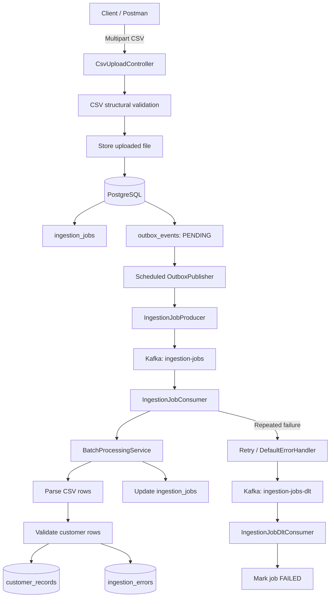
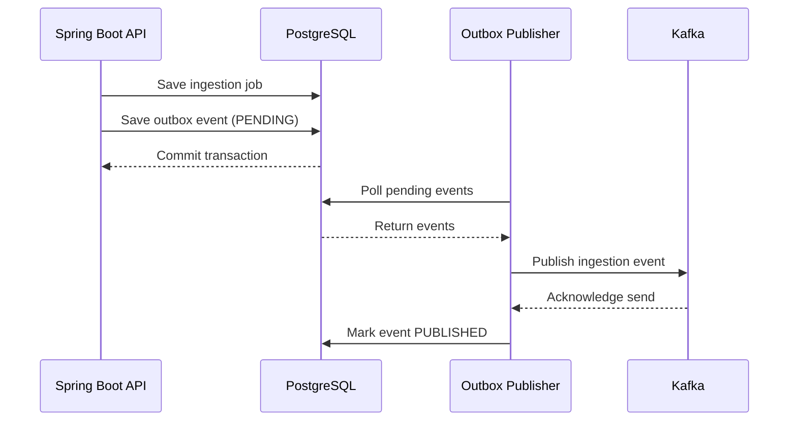

# Distributed Data Ingestion & Processing Platform

A Java/Spring Boot backend for accepting CSV uploads, tracking ingestion jobs, validating and processing customer records in batches, and using Apache Kafka for asynchronous processing. PostgreSQL stores jobs, customer records, row-level errors, and transactional outbox events.

**Current progress:** Phases 1–4 have been implemented and exercised locally. Both the normal Kafka processing path and the retry/Dead Letter Topic (DLT) failure path have been tested. Phase 5 (idempotency, recovery, and stronger concurrency protection) is planned.

## Contents

1. [Overview](#1-overview)
2. [Architecture](#2-architecture)
3. [End-to-end workflow](#3-end-to-end-workflow)
4. [Database tables and lifecycle](#4-database-tables-and-lifecycle)
5. [Java classes and responsibilities](#5-java-classes-and-responsibilities)
6. [Transactional Outbox Pattern](#6-transactional-outbox-pattern)
7. [Kafka retries and Dead Letter Topic](#7-kafka-retries-and-dead-letter-topic)
8. [Statuses](#8-statuses)
9. [Flyway migrations](#9-flyway-migrations)
10. [Technology and infrastructure](#10-technology-and-infrastructure)
11. [Configuration and running locally](#11-configuration-and-running-locally)
12. [Testing and verification](#12-testing-and-verification)
13. [Known limitations and roadmap](#13-known-limitations-and-roadmap)
14. [Interview explanation](#14-interview-explanation)

---

## 1. Overview

The platform separates CSV upload from background processing. This avoids making an HTTP request wait for an entire large file to be processed and provides a way to track jobs and handle asynchronous failures.

At a high level:

1. A client submits a CSV through a multipart upload request.
2. The backend validates the CSV structure and stores the file.
3. The backend creates an ingestion job and an outbox event.
4. A scheduled publisher sends pending outbox events to Kafka.
5. A Kafka consumer receives the event and starts batch processing.
6. Valid customer records are saved; invalid rows are recorded separately.
7. The job status and row counters are updated.
8. If message processing repeatedly fails, the event is routed to a DLT and the DLT consumer marks the job as failed.

## 2. Architecture



The main components are:

| Component | Responsibility |
|---|---|
| Spring Boot REST API | Accepts requests and exposes job-related APIs |
| CSV validation and storage | Checks file structure and stores uploaded files |
| PostgreSQL | Persists jobs, records, row errors, and outbox events |
| Transactional Outbox | Records events in the same database transaction as the associated job operation |
| Outbox Publisher | Polls pending events and publishes them to Kafka |
| Kafka | Carries ingestion events asynchronously |
| Kafka consumer | Starts processing for the referenced job |
| Batch processing | Parses, validates, and persists records |
| Retry and DLT handling | Retries failed message processing and routes exhausted messages to a DLT |

## 3. End-to-end workflow

### Step 1 — One multipart CSV upload request

For the CSV ingestion flow, job creation and file upload are part of the same client-facing multipart request. The client does not need to call one endpoint to create a job and another endpoint to upload the CSV.

`CsvUploadController` receives the multipart request and coordinates the upload workflow.

The exact route and multipart part names should be taken from the current controller source; they are not hard-coded in this README.

### Step 2 — Validate the CSV structure and store the file

Classes involved:

- `CsvUploadController`
- `CsvValidationService`
- `CsvStorageService`
- `CsvUploadResponse`
- `GlobalExceptionHandler`

The upload workflow validates the CSV structure, including required headers, and stores the file in the configured upload directory:

```properties
app.upload-dir=./uploads
```

File-level and row-level validation are different:

- **File-level validation** checks whether the CSV has the required structure and headers.
- **Row-level validation** checks whether each customer record contains valid data.

A CSV missing the required `email` header was tested. The API returned HTTP 400, and that invalid-upload test did not create a new job or outbox event.

### Step 3 — Create the ingestion job and outbox event

The upload workflow creates an `IngestionJob` and its corresponding outbox event.

Classes involved:

- `IngestionJob`
- `IngestionJobRepository`
- `IngestionJobService`
- `OutboxService`
- `OutboxEvent`
- `OutboxEventRepository`

The outbox creation method uses `Propagation.MANDATORY`:

```java
@Transactional(propagation = Propagation.MANDATORY)
public void createJobEvent(UUID jobId) {
    OutboxEvent event =
            new OutboxEvent(jobId, "INGESTION_JOB_CREATED");
    outboxEventRepository.save(event);
}
```

`MANDATORY` means the method must participate in an existing transaction. The intended transaction boundary commits the job and its outbox event together; if the transaction rolls back, both database changes roll back.

**Controller distinction:** `CsvUploadController` handles the multipart CSV upload flow. `IngestionJobController` is a separate controller retained for job-related API operations, including the metadata-only job workflow and job retrieval functionality. Check its current mappings for the exact routes and request types. It is not the controller handling the multipart CSV upload.

### Step 4 — Publish pending outbox events to Kafka

Classes involved:

- `OutboxPublisher`
- `OutboxEventStateService`
- `OutboxEventRepository`
- `IngestionJobProducer`

Current configuration:

```properties
app.outbox.batch-size=50
app.outbox.poll-interval-ms=2000
```

The scheduled publisher polls for up to 50 pending events approximately every two seconds. The repository query retrieves events in `PENDING` status ordered by creation time.

For each event, the publisher creates an `IngestionJobEvent`, calls the producer, waits for the Kafka send result, and then updates the outbox state.

The producer uses the job ID as the Kafka record key:

```java
kafkaTemplate.send(topic, event.jobId().toString(), event);
```

Messages with the same key are routed consistently to the same Kafka partition.

On a successful Kafka send, the outbox event becomes `PUBLISHED` and `published_at` is populated. If publishing fails, the event remains `PENDING`, its attempt count increases, and its most recent error is recorded.

### Step 5 — Kafka consumer receives the event

Class: `IngestionJobConsumer`

The listener subscribes to `ingestion-jobs` using consumer group `ingestion-worker-group`. It receives an `IngestionJobEvent` and calls:

```java
processingService.process(event.jobId());
```

This starts processing independently of the original HTTP request.

### Step 6 — Parse, validate, and persist rows

Classes involved:

- `BatchProcessingService` — coordinates processing for a job.
- `CsvRecordParser` — reads and parses CSV rows.
- `CustomerRecordValidator` — validates individual customer records.
- `BatchPersistenceService` — persists valid records and records processing failures.

Configured batch size:

```properties
app.processing.batch-size=500
```

The intended processing unit is 500 records. For example, 1,200 data rows can be handled in batches of 500, 500, and 200.

For a structurally valid CSV, individual rows can still be invalid. Valid rows are saved in `customer_records`; invalid rows are recorded in `ingestion_errors`. Job counters and status are updated in `ingestion_jobs`.

Example:

```csv
customerId,name,email
C201,John,not-an-email
C202,,david@example.com
C203,Alex,alex@example.com
```

The file can pass structural validation even though some rows fail record validation.

### Step 7 — Handle processing failures

If the Kafka listener throws an exception, Spring Kafka's configured error handler retries message processing. Once retries are exhausted, the event is published to the DLT. The DLT consumer marks the associated job `FAILED`. Details are in [Kafka retries and Dead Letter Topic](#7-kafka-retries-and-dead-letter-topic).

---

## 4. Database tables and lifecycle

### `ingestion_jobs`

**Purpose:** Master record for each ingestion request and its processing lifecycle. It tracks the job identity, status, file/job metadata, row counters, and timestamps. Exact columns are defined by the migration and entity.

| Workflow stage | Operation | Status/effect |
|---|---|---|
| Job accepted | INSERT | Initial status set by entity/service |
| CSV upload | UPDATE / association | File details associated with job |
| Processing | UPDATE | Processing state/counters as implemented |
| All rows succeed | UPDATE | `COMPLETED` |
| Some rows fail | UPDATE | `COMPLETED_WITH_ERRORS` |
| Processing failure reaches DLT | UPDATE | `FAILED` |

Statuses observed in testing include `COMPLETED`, `COMPLETED_WITH_ERRORS`, and `FAILED`. Check `IngestionJobStatus.java` and the processing services for the complete enum and exact transitions.

### `customer_records`

**Purpose:** Stores successfully validated customer records.

| Workflow stage | Operation |
|---|---|
| File upload | No customer-row insert |
| CSV parsing | No insert until the record is accepted |
| Row passes validation | INSERT |
| Row fails validation | No customer record inserted for that row |

Exact columns and constraints are defined in V3 and the corresponding entity mapping.

### `ingestion_errors`

**Purpose:** Stores row-level validation or processing errors.

An observed validation error included `row_number = 2`, `error_code = VALIDATION_ERROR`, and `error_message = email is invalid`.

| Workflow stage | Operation |
|---|---|
| Valid row | No error insert |
| Invalid row | INSERT error details |
| Job completes with row errors | Error details remain available |

### `outbox_events`

**Purpose:** Stores events that must be published to Kafka.

| Column | Purpose |
|---|---|
| `id` | Unique outbox event ID |
| `job_id` | Associated ingestion job ID |
| `event_type` | Event type, e.g. `INGESTION_JOB_CREATED` |
| `status` | Outbox publishing state |
| `attempts` | Number of publishing failures recorded |
| `created_at` | Event creation time |
| `published_at` | Successful publish timestamp |
| `last_error` | Most recent publishing failure detail |

Lifecycle:

| Stage | Operation | Status |
|---|---|---|
| Event created | INSERT | `PENDING` |
| Publisher reads event | SELECT | `PENDING` |
| Kafka send succeeds | UPDATE | `PUBLISHED` |
| Kafka send fails | UPDATE | Remains `PENDING`; attempts/error updated |

Current enum:

```java
public enum OutboxStatus {
    PENDING,
    PUBLISHED
}
```

### Kafka topics and offsets

Kafka topics are not PostgreSQL tables. Kafka stores messages and manages consumer offsets separately.

| Topic | Purpose |
|---|---|
| `ingestion-jobs` | Normal ingestion events |
| `ingestion-jobs-dlt` | Events that exhausted processing retries |

Consumer groups:

- `ingestion-worker-group`
- `ingestion-dlt-handler-group`

### Job status versus outbox status

These states describe different things:

- `ingestion_jobs.status` describes the lifecycle/outcome of ingestion work.
- `outbox_events.status` describes whether the event was published to Kafka.

An outbox event can be `PUBLISHED` while its job later becomes `FAILED`: Kafka accepted the event, but the consumer did not complete the work. `PUBLISHED` does not mean customer records were saved.

Marking a job `FAILED` in the DLT handler also does not automatically roll back customer records committed by earlier processing batches.

---

## 5. Java classes and responsibilities

Base package:

```text
com.surya.DistributedDataPlatform
```

Project structure:

```text
src/main/java/com/surya/DistributedDataPlatform
├── DistributedDataPlatformApplication.java
├── common/exception
│   ├── ApiError.java
│   ├── GlobalExceptionHandler.java
│   └── IngestionJobNotFoundException.java
├── jobs
│   ├── controller
│   │   ├── CsvUploadController.java
│   │   └── IngestionJobController.java
│   ├── dto
│   │   ├── CreateIngestionJobRequest.java
│   │   ├── CsvUploadResponse.java
│   │   └── IngestionJobResponse.java
│   ├── entity
│   │   ├── IngestionJob.java
│   │   └── IngestionJobStatus.java
│   ├── repository/IngestionJobRepository.java
│   └── service
│       ├── CsvStorageService.java
│       ├── CsvValidationService.java
│       └── IngestionJobService.java
├── config
│   ├── KafkaProducerConfig.java
│   └── KafkaConsumerConfig.java
├── messaging
│   ├── consumer
│   │   ├── IngestionJobConsumer.java
│   │   └── IngestionJobDltConsumer.java
│   ├── error/KafkaErrorHandlerConfig.java
│   ├── event/IngestionJobEvent.java
│   ├── producer/IngestionJobProducer.java
│   └── outbox
│       ├── entity
│       │   ├── OutboxEvent.java
│       │   └── OutboxStatus.java
│       ├── repository/OutboxEventRepository.java
│       └── service
│           ├── OutboxService.java
│           ├── OutboxEventStateService.java
│           └── OutboxPublisher.java
└── processing
    ├── parser/CsvRecordParser.java
    ├── service
    │   ├── BatchProcessingService.java
    │   └── BatchPersistenceService.java
    └── validator/CustomerRecordValidator.java
```

### Class reference

| Class | Responsibility |
|---|---|
| `CsvUploadController` | Receives multipart CSV uploads and coordinates the upload workflow |
| `IngestionJobController` | Handles separate job-related API operations |
| `IngestionJobService` | Job creation and lifecycle operations |
| `CsvStorageService` | Stores uploaded CSV files |
| `CsvValidationService` | Validates CSV structure |
| `IngestionJobRepository` | Database access for jobs |
| `IngestionJob` | Job database entity |
| `IngestionJobStatus` | Job status definitions |
| `CreateIngestionJobRequest` | Job creation request DTO |
| `CsvUploadResponse` | CSV upload response DTO |
| `IngestionJobResponse` | Job response DTO |
| `BatchProcessingService` | Coordinates CSV batch processing |
| `BatchPersistenceService` | Persists processing results and failures |
| `CsvRecordParser` | Parses CSV rows |
| `CustomerRecordValidator` | Validates customer data |
| `IngestionJobEvent` | Kafka event representation |
| `IngestionJobProducer` | Publishes events to Kafka |
| `IngestionJobConsumer` | Consumes normal ingestion events |
| `IngestionJobDltConsumer` | Consumes failed events from DLT |
| `KafkaErrorHandlerConfig` | Configures retry and DLT recovery |
| `OutboxService` | Creates outbox events |
| `OutboxEventStateService` | Reads and updates outbox state |
| `OutboxPublisher` | Polls and publishes pending events |
| `OutboxEvent` | Outbox database entity |
| `OutboxStatus` | Outbox status enum |
| `OutboxEventRepository` | Outbox database access |
| `KafkaProducerConfig` | Configures Kafka producer |
| `KafkaConsumerConfig` | Configures consumer factory and listener container factory |
| `GlobalExceptionHandler` | Centralized API exception handling |
| `IngestionJobNotFoundException` | Job-not-found exception |
| `ApiError` | API error representation |

### Normal processing call path

```text
Client
  -> CsvUploadController
  -> CsvValidationService
  -> CsvStorageService
  -> job persistence / IngestionJobService
  -> OutboxService.createJobEvent(jobId)
  -> OutboxEventRepository.save(...)
  -> OutboxPublisher.publishPendingEvents()
  -> OutboxEventStateService.findPendingEvents(...)
  -> IngestionJobProducer.publish(...)
  -> Kafka
  -> IngestionJobConsumer.consume(...)
  -> BatchProcessingService.process(jobId)
  -> CsvRecordParser
  -> CustomerRecordValidator
  -> BatchPersistenceService
```

### Failure path

```text
IngestionJobConsumer.consume(...)
  -> consumer exception
  -> KafkaErrorHandlerConfig / DefaultErrorHandler
  -> retry with exponential backoff
  -> DeadLetterPublishingRecoverer
  -> ingestion-jobs-dlt
  -> IngestionJobDltConsumer.handleDeadLetter(...)
  -> BatchPersistenceService.fail(jobId)
  -> ingestion_jobs.status = FAILED
```

These are the architectural call paths. For exact line-by-line method ordering, consult the current source files.

---

## 6. Transactional Outbox Pattern

### Problem

If the application commits an ingestion job to PostgreSQL and Kafka is unavailable when it tries to publish the corresponding event, the job can exist without a message to trigger processing.

Publishing to Kafka before the database transaction commits has the opposite risk: Kafka could receive an event for a job whose database transaction later rolls back.

### Approach

The application saves the job and its outbox event in the same database transaction. A separate scheduled publisher reads pending events and sends them to Kafka.



The pattern makes event publication recoverable, but it does not by itself provide exactly-once processing. A publisher can send an event and fail before recording `PUBLISHED`, so the event may be sent again. Consumer idempotency is therefore important.

---

## 7. Kafka retries and Dead Letter Topic

### Topics

| Topic | Purpose |
|---|---|
| `ingestion-jobs` | Normal ingestion events |
| `ingestion-jobs-dlt` | Events that exhaust consumer retries |

Both topics were created locally with three partitions and replication factor one.

### Producer

`IngestionJobProducer` uses `KafkaTemplate<String, IngestionJobEvent>` and sends events to the configured normal topic. The job ID is used as the record key.

### Main consumer

`IngestionJobConsumer` listens to `ingestion-jobs` as part of `ingestion-worker-group`. It calls `BatchProcessingService.process(jobId)`.

### Consumer configuration

`KafkaConsumerConfig` defines the bootstrap server, consumer group, offset reset behavior, commit setting, String key deserializer, JSON event deserializer, trusted event package, and `kafkaListenerContainerFactory`.

`@EnableKafka` is enabled in the application configuration so annotated listeners are registered.

### Retry configuration

`KafkaErrorHandlerConfig` uses Spring Kafka's `DefaultErrorHandler`, `DeadLetterPublishingRecoverer`, and `ExponentialBackOff`:

```java
ExponentialBackOff backOff =
        new ExponentialBackOff(1000L, 2.0);

backOff.setMaxElapsedTime(10000L);
```

The retry delay grows exponentially, starting at approximately one second, until the configured elapsed-time limit is reached. The exact number of delivery attempts depends on Spring Kafka's backoff and error-handler semantics.

### DLT consumer

`IngestionJobDltConsumer` listens to `ingestion-jobs-dlt` with group `ingestion-dlt-handler-group`. It logs the job ID and event ID and calls:

```java
persistenceService.fail(event.jobId());
```

This marks the associated ingestion job `FAILED`.

### Failure test performed

A temporary property was used to deliberately make the main consumer throw an exception:

```properties
app.kafka.test-fail-enabled=true
```

This allowed retry and DLT behavior to be tested.

Observed:

- Main and DLT consumer groups joined their topic partitions.
- Retry log entries appeared.
- Six events were observed in DLT consumer logs.
- Six associated jobs were marked `FAILED`.
- The associated outbox events were `PUBLISHED`, with zero recorded publishing failures.

The flag was then disabled:

```properties
app.kafka.test-fail-enabled=false
```

The application was restarted and a fresh valid CSV was uploaded. It completed successfully. Keep the test flag disabled during normal use; the temporary failure branch should eventually be removed or isolated in test configuration.

---

## 8. Statuses

### Ingestion job statuses

Statuses observed in the application:

| Status | Meaning |
|---|---|
| `COMPLETED` | Job completed successfully |
| `COMPLETED_WITH_ERRORS` | Job completed with row-level errors |
| `FAILED` | Job failed at the processing/job level, including the tested DLT path |

Check `IngestionJobStatus.java` and the processing services for the full enum and exact intermediate transitions.

### Outbox statuses

```java
public enum OutboxStatus {
    PENDING,
    PUBLISHED
}
```

| Status | Meaning |
|---|---|
| `PENDING` | Waiting to be published or eligible for another publishing attempt |
| `PUBLISHED` | Kafka acknowledged the send and the publisher recorded it |

**Do not confuse these states.** `PUBLISHED` means the event was sent to Kafka; it does not mean the ingestion job completed successfully.

---

## 9. Flyway migrations

Flyway manages schema changes through versioned SQL files.

| Migration | Purpose |
|---|---|
| `V1__create_ingestion_jobs.sql` | Creates the ingestion jobs table |
| `V2__allow_metadata_only_jobs.sql` | Adjusts schema to support metadata-only jobs |
| `V3__create_customer_records_and_ingestion_errors.sql` | Creates customer records and row-error tables |
| `V4__create_outbox_events.sql` | Creates the outbox events table |
| `V5__align_outbox_events_schema.sql` | Aligns the outbox table with the current Java entity |

V5 made these changes:

```sql
ALTER TABLE outbox_events
    RENAME COLUMN aggregate_id TO job_id;

ALTER TABLE outbox_events
    DROP COLUMN payload;

ALTER TABLE outbox_events
    ADD COLUMN last_error VARCHAR(2000);
```

Hibernate schema auto-update is disabled:

```properties
spring.jpa.hibernate.ddl-auto=none
```

Flyway owns schema evolution. The local application validated all five migrations, with schema version 5 applied.

---

## 10. Technology and infrastructure

| Technology | Use |
|---|---|
| Java 25 | Application runtime |
| Spring Boot 4.0.9 | Backend framework |
| Gradle | Build and dependency management |
| PostgreSQL 17 | Relational database |
| Apache Kafka 4.1.0 | Event messaging |
| Docker Compose | Local infrastructure |
| Flyway | Database migrations |
| Spring Data JPA / Hibernate | Persistence |
| Spring Kafka | Kafka integration |
| DBeaver Community | Database inspection |
| Postman | API testing |
| IntelliJ IDEA Community | Development environment |

### Docker services

**PostgreSQL**
- Container: `ingestion-postgres`
- Image: `postgres:17`
- Database: `dataplatform`
- User: `dataplatform`
- Local port: `5432`
- Persistent volume: `postgres_data`

**Kafka**
- Container: `ingestion-kafka`
- Image: `apache/kafka:4.1.0`
- Local port: `9092`
- Single-node KRaft broker/controller configuration

The local development password is `devpassword` in the Compose setup. Do not use this credential in a deployed environment.

Create the topics:

```powershell
docker exec ingestion-kafka /opt/kafka/bin/kafka-topics.sh --bootstrap-server localhost:9092 --create --if-not-exists --topic ingestion-jobs --partitions 3 --replication-factor 1

docker exec ingestion-kafka /opt/kafka/bin/kafka-topics.sh --bootstrap-server localhost:9092 --create --if-not-exists --topic ingestion-jobs-dlt --partitions 3 --replication-factor 1
```

List topics:

```powershell
docker exec ingestion-kafka /opt/kafka/bin/kafka-topics.sh --bootstrap-server localhost:9092 --list
```

Inspect the main consumer group:

```powershell
docker exec ingestion-kafka /opt/kafka/bin/kafka-consumer-groups.sh --bootstrap-server localhost:9092 --describe --group ingestion-worker-group
```

Inspect the DLT consumer group:

```powershell
docker exec ingestion-kafka /opt/kafka/bin/kafka-consumer-groups.sh --bootstrap-server localhost:9092 --describe --group ingestion-dlt-handler-group
```

Zero consumer lag means the group is caught up with messages currently available in the inspected partitions. It does not independently prove a particular job completed; verify the job in PostgreSQL too.

---

## 11. Configuration and running locally

Relevant local `application.properties` values:

```properties
spring.application.name=distributed-data-platform

spring.datasource.url=jdbc:postgresql://localhost:5432/dataplatform
spring.datasource.username=dataplatform
spring.datasource.password=${DB_PASSWORD:devpassword}
spring.datasource.driver-class-name=org.postgresql.Driver

spring.jpa.hibernate.ddl-auto=none
spring.jpa.open-in-view=false

spring.servlet.multipart.max-file-size=10MB
spring.servlet.multipart.max-request-size=11MB

app.upload-dir=./uploads

app.processing.batch-size=500
app.processing.poll-delay-ms=2000

spring.kafka.bootstrap-servers=localhost:9092
spring.kafka.producer.key-serializer=org.apache.kafka.common.serialization.StringSerializer
spring.kafka.producer.value-serializer=org.springframework.kafka.support.serializer.JsonSerializer

spring.kafka.consumer.group-id=ingestion-worker-group
spring.kafka.consumer.auto-offset-reset=earliest
spring.kafka.consumer.enable-auto-commit=false
spring.kafka.consumer.key-deserializer=org.apache.kafka.common.serialization.StringDeserializer
spring.kafka.consumer.value-deserializer=org.springframework.kafka.support.serializer.JsonDeserializer
spring.kafka.consumer.properties[spring.json.trusted.packages]=com.surya.DistributedDataPlatform.messaging.event

app.kafka.topic.ingestion-jobs=ingestion-jobs
app.kafka.topic.ingestion-jobs-dlt=ingestion-jobs-dlt

app.outbox.batch-size=50
app.outbox.poll-interval-ms=2000

# Temporary test property. Keep false for normal processing.
app.kafka.test-fail-enabled=false
```

Use environment variables or a secret manager for credentials outside local development. Do not commit production secrets.

### Prerequisites

- Java 25 installed.
- Docker Desktop running.
- Git installed.

From the project root:

```powershell
docker compose config
docker compose up -d
docker compose ps
```

Start Spring Boot:

```powershell
.\gradlew.bat bootRun
```

The application connects to PostgreSQL at `localhost:5432` and Kafka at `localhost:9092`.

Check application health:

```powershell
Invoke-RestMethod http://localhost:8080/actuator/health
```

The expected overall health status is `UP`.

---

## 12. Testing and verification

### Automated tests

Run:

```powershell
.\gradlew.bat clean test
```

A previous run completed with `BUILD SUCCESSFUL` and reported nine tests. Re-run the suite against the current source before merging.

Warnings previously observed included deprecated Kafka serializer API usage and deprecated APIs in CSV validation/test code. They were warnings, not build failures.

### CSV structural validation

A CSV missing the required email header was uploaded.

Observed:
- HTTP 400.
- No new ingestion job row for that invalid-upload test.
- No corresponding outbox event row.

### Row-level validation

A structurally valid CSV containing invalid row data was uploaded.

Observed:
- Job status `COMPLETED_WITH_ERRORS`.
- One processed row.
- One failed row.
- An `ingestion_errors` entry with `VALIDATION_ERROR` and `email is invalid`.

A discrepancy between the number of CSV data rows and the reported `total_rows` was noticed. Row counting and missing-field validation should be investigated before considering that test case fully resolved.

### Kafka failure and DLT test

A temporary failure flag forced the main consumer to throw an exception.

Observed:
- Main consumer joined all three `ingestion-jobs` partitions.
- DLT consumer joined all three `ingestion-jobs-dlt` partitions.
- Retry log entries appeared.
- Six events reached the DLT consumer logs.
- Six associated jobs were marked `FAILED`.
- Their outbox events were `PUBLISHED`.

This verified the retry and DLT path.

### Normal Kafka processing test

The temporary flag was changed to `false`. The application was restarted and a fresh valid CSV was uploaded.

Verified job:

```text
c059dbd1-174b-4c95-beef-20eebd44d5be
```

Observed:

| Field | Result |
|---|---:|
| Status | `COMPLETED` |
| Total rows | 1 |
| Processed rows | 1 |
| Failed rows | 0 |

The corresponding outbox event was `PUBLISHED`, with zero publishing failures. The main Kafka consumer group had zero lag across its three partitions when inspected.

### Useful SQL queries

Latest jobs:

```sql
SELECT
    id,
    status,
    total_rows,
    processed_rows,
    failed_rows,
    completed_at
FROM ingestion_jobs
ORDER BY created_at DESC
LIMIT 10;
```

Outbox events:

```sql
SELECT
    id,
    job_id,
    event_type,
    status,
    attempts,
    last_error,
    published_at
FROM outbox_events
ORDER BY created_at DESC
LIMIT 10;
```

Customer records:

```sql
SELECT *
FROM customer_records
ORDER BY created_at DESC
LIMIT 10;
```

Row-level errors:

```sql
SELECT *
FROM ingestion_errors
LIMIT 10;
```

If a sort column is needed for `ingestion_errors`, use the column defined in its migration/entity.

---

## 13. Known limitations and roadmap

Phases 1–4 establish the core upload, persistence, outbox, Kafka, batch processing, retry, and DLT workflows. These improvements remain planned or need further verification:

| Area | Current state | Planned improvement |
|---|---|---|
| Consumer idempotency | Complete duplicate-event protection not yet verified | Track processed event IDs or equivalent idempotency key |
| Duplicate customer records | Complete duplicate protection not yet verified | Add appropriate database constraints and/or idempotent persistence |
| Concurrent outbox publishers | No confirmed atomic claim/locking mechanism | Add safe row claiming/locking |
| Outbox restart recovery | Scheduled polling of pending events exists | Test restart recovery and strengthen guarantees |
| DLT duplicate handling | DLT handler calls `fail(jobId)` | Guard terminal-state transitions and duplicate delivery |
| Publisher interruption | Interrupt restoration needs improvement | Restore thread interrupt status |
| Outbox timestamp | Publisher currently creates the event timestamp at publish time | Consider using the original outbox `createdAt` |
| Outbox persistence errors | Failure-recording can itself fail if PostgreSQL is unavailable | Improve operational error handling |
| CSV row counting | Discrepancy observed in an earlier test | Investigate total-row and missing-field accounting |
| Integration coverage | Manual scenarios exercised; broader automated coverage remains | Add integration tests and observability |

### Phase 5 — Retry, recovery, and idempotency

Planned work:

1. **Idempotent consumers:** prevent the same event from applying database effects more than once.
2. **Duplicate record prevention:** prevent repeated ingestion from creating unintended duplicate customer records.
3. **Outbox recovery:** ensure pending events are recoverable after application restarts.
4. **Concurrent publisher protection:** prevent multiple publisher instances from claiming the same pending event simultaneously.
5. **Safe retry handling:** handle transient failures without corrupting job state.
6. **DLT state protection:** avoid repeated failure handling overwriting an already terminal job state.

### Later phases

- **Phase 6 — Testing and observability:** broader automated tests, metrics, and operational visibility.
- **Phase 7 — Docker, CI, and deployment:** production-oriented containerization, CI pipeline, and deployment configuration.
- **Phase 8 — Documentation:** complete architecture, setup, API, operations, and troubleshooting documentation.

---

## 14. Interview explanation

### Short project explanation

> I developed a distributed data ingestion and processing platform using Java, Spring Boot, PostgreSQL, and Apache Kafka.
>
> The application accepts CSV uploads and creates ingestion jobs to track each request independently of the HTTP upload. I implemented file-level validation and row-level validation, and process records in batches.
>
> To make asynchronous event publishing reliable, I implemented the Transactional Outbox Pattern. The job and its outbox event are persisted within a database transaction, and a scheduled publisher sends pending events to Kafka.
>
> I implemented Kafka producers and consumers to decouple upload handling from background processing. I also configured retry handling with exponential backoff and a Dead Letter Topic for messages that repeatedly fail.
>
> PostgreSQL stores ingestion jobs, valid customer records, row-level errors, and outbox events. This allows the system to track processing outcomes and failures.

### Concepts to prepare for interviews

- Why asynchronous processing is useful for large CSV uploads.
- Why file-level validation differs from row-level validation.
- Why the Transactional Outbox Pattern is needed.
- What Kafka topics, partitions, message keys, and consumer groups are.
- How consumer offsets and lag work.
- How exponential backoff works.
- What a Dead Letter Topic is and why it is useful.
- Why `PUBLISHED` does not mean the ingestion job is `COMPLETED`.
- Why at-least-once delivery requires idempotent consumers.
- Why a job marked `FAILED` does not automatically roll back previously committed batches.

---

## Repository

GitHub: https://github.com/codewithsurya27/distributed-data-platform

This README documents the implementation and test evidence established through the first four phases. Where exact endpoint mappings, entity columns, or status transitions are not reproduced here, the current Java source and Flyway migrations remain the source of truth.
