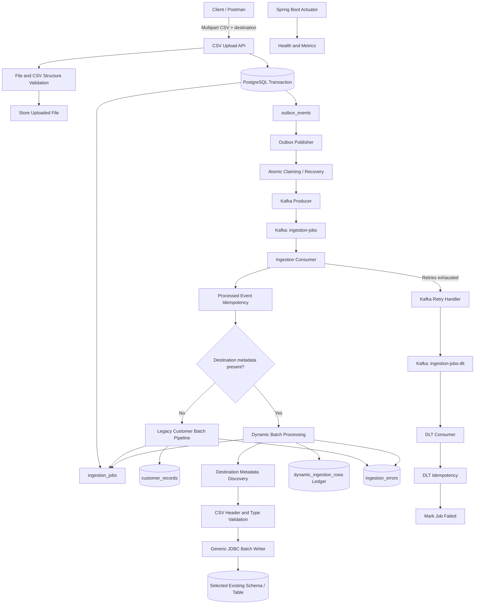

# Distributed Data Ingestion & Processing Platform

A distributed CSV ingestion backend built with **Java 25, Spring Boot 4, PostgreSQL, Apache Kafka, and Gradle**.

The platform accepts CSV uploads, creates trackable ingestion jobs, and processes data asynchronously in batches. It supports both the original customer-record workflow and a dynamic ingestion workflow that targets different existing PostgreSQL tables across schemas.

It implements the **Transactional Outbox pattern**, Kafka retries and Dead Letter Topic (DLT) handling, consumer and row-level idempotency, destination-key conflict handling, concurrent outbox claiming, abandoned-event recovery, structured logging, application health monitoring, and automated tests.

The project also includes Docker Compose orchestration and a GitHub Actions CI workflow.

**Project status:** Phases 1–8 completed. Phase 9 — Dynamic Multi-Table PostgreSQL Ingestion — has completed implementation batches 1–11; batch 12 covers final integration and release-readiness verification.

---

## Contents

1. Overview
2. Architecture
3. End-to-end workflow
4. Reliability and failure handling
5. Database model
6. Technology stack
7. Project structure
8. Configuration
9. Run with Docker Compose
10. Run locally without Docker
11. API and verification
12. Automated tests
13. Observability and monitoring
14. CI pipeline
15. Implementation roadmap
16. Dynamic Multi-Table PostgreSQL Ingestion

---

## 1. Overview

The platform separates synchronous file uploads from background data processing.

When a client uploads a CSV:

1. The API validates the file structure.
2. The application stores the uploaded file.
3. An ingestion job is created in PostgreSQL.
4. A corresponding outbox event is persisted in the same database transaction.
5. A scheduled publisher sends the event to Kafka.
6. A Kafka consumer processes the CSV asynchronously.
7. The job status and processing counters are updated.

### Core capabilities

- Multipart CSV upload and structural validation.
- Ingestion job creation and status tracking.
- Row-level customer validation and error recording.
- Dynamic CSV-to-table validation for existing PostgreSQL destinations.
- Generic JDBC batch insertion across multiple schemas and tables.
- Row-level dynamic ingestion ledger and destination-key conflict handling.
- Batch persistence to PostgreSQL.
- Asynchronous processing using Apache Kafka.
- Transactional Outbox for reliable event publication.
- Kafka retries with exponential backoff and DLT handling.
- Main consumer idempotency.
- Duplicate customer-ID detection.
- Atomic outbox event claiming using PostgreSQL locking.
- Recovery of abandoned outbox events.
- Configurable retry limits.
- Idempotent DLT event handling.
- Structured JSON logging and correlation IDs.
- Spring Boot Actuator health endpoints.
- Custom ingestion metrics.
- Docker Compose deployment.
- GitHub Actions continuous integration.
- Automated unit and integration tests.

---

## 2. Architecture



### Component responsibilities

| Component | Responsibility |
|---|---|
| REST controllers | Accept CSV uploads, expose ingestion-job operations, and expose destination metadata |
| Upload validation and storage | Validate the uploaded file and persist it for asynchronous processing |
| Destination metadata service | Inspect existing PostgreSQL schemas, tables, columns, types, defaults, identity, and generated-column metadata |
| Dynamic CSV validator | Match CSV headers to destination columns and validate required fields and supported PostgreSQL data types |
| Dynamic JDBC writer | Build safe, identifier-quoted INSERT statements and bind CSV values as parameters |
| Dynamic row ledger | Track each dynamic job row as inserted or rejected to make row processing retry-safe |
| PostgreSQL | Persist jobs, destination metadata, customer records, errors, outbox events, and processing ledgers |
| Transactional Outbox | Persist events with the associated job transaction |
| Outbox publisher | Claim and publish pending events |
| Kafka consumer | Trigger asynchronous processing and route jobs to the legacy or dynamic path |
| Batch processor | Parse, validate, and persist records in batches |
| Processed-event service | Prevent duplicate Kafka event processing |
| Kafka error handler | Retry failed processing and forward exhausted messages to the DLT |
| DLT consumer | Record DLT handling idempotently and mark associated jobs failed |
| Outbox recovery service | Recover stale `PROCESSING` outbox events |

---|---|
| REST controllers | Accept uploads and expose ingestion-job operations |
| CSV validation | Validate file structure and required headers |
| PostgreSQL | Persist jobs, customer records, errors, and events |
| Transactional Outbox | Persist events with associated database operations |
| Outbox publisher | Claim and publish pending events |
| Kafka producer | Publish ingestion events |
| Kafka consumer | Trigger asynchronous processing |
| Batch processor | Parse, validate, and persist records in batches |
| Processed-event service | Prevent duplicate event processing |
| Kafka error handler | Retry failed processing and forward exhausted messages to DLT |
| DLT consumer | Record DLT handling and mark associated jobs failed |
| Outbox recovery service | Recover stale PROCESSING events |

---

## 3. End-to-end workflow

### 3.1 Upload and job creation

1. The client submits a CSV through the multipart upload endpoint.
2. The controller coordinates validation and file storage.
3. File-level validation checks the CSV structure and required headers.
4. The application creates an ingestion job.
5. An outbox event is created in the same database transaction.
6. The API responds without waiting for background processing to finish.

### 3.2 Outbox publication

1. `OutboxPublisher` periodically looks for pending events.
2. `OutboxEventStateService` claims events using PostgreSQL `FOR UPDATE SKIP LOCKED`.
3. Claimed events transition to `PROCESSING`.
4. The Kafka producer publishes an event to `ingestion-jobs`.
5. Successfully published events transition to `PUBLISHED`.
6. Failed attempts are recorded and retried until the configured maximum is reached.

The Kafka record key is the job ID.

### 3.3 Background processing

1. `IngestionJobConsumer` receives the event.
2. `ProcessedEventService` attempts to claim the event ID.
3. Previously processed event IDs are ignored.
4. The consumer routes the job to the appropriate processing path:
    - Jobs without destination metadata use the legacy customer-record pipeline.
    - Jobs with a destination schema and table use the dynamic ingestion pipeline.
5. The job is finalized with its resulting status and row counters.

### 3.4 Dynamic multi-table processing

For a dynamic ingestion job:

1. The job's destination schema and table are read from persisted job metadata.
2. The application discovers the existing destination table's column metadata from PostgreSQL.
3. CSV headers are normalized and mapped to destination columns.
4. The validator checks unknown or duplicate headers, missing required columns, null required values, and supported PostgreSQL data types.
5. Identity and generated columns are not treated as required CSV fields; database defaults and generated values are left to PostgreSQL when the CSV omits those columns.
6. `DynamicJdbcBatchWriter` inserts valid rows using safely quoted identifiers and parameterized values.
7. Destination-key conflicts are rejected and recorded as `DUPLICATE_DESTINATION_KEY`.
8. `dynamic_ingestion_rows` records each `(job_id, row_number)` outcome as `INSERTED` or `REJECTED`.
9. Job counters and row-level errors are updated transactionally with the ledger and destination writes.

The initial dynamic implementation supports multiple existing schemas and tables in one configured PostgreSQL database. It does not create or alter destination tables.

### 3.5 Validation

File-level validation checks whether the uploaded CSV is non-empty and structurally readable.

For the legacy customer workflow, row-level validation checks customer values and duplicate customer IDs.

For dynamic jobs, destination metadata drives header and data-type validation. Required destination columns must be supplied unless they are nullable, have a database default, or are identity/generated columns. Blank values in required fields are rejected. Unknown or duplicate mapped headers are rejected.

A structurally valid CSV can still contain invalid rows. Valid rows can be persisted while rejected rows are recorded in `ingestion_errors`.

For dynamic destination-key conflicts, the row is recorded as `DUPLICATE_DESTINATION_KEY`; the destination table is not modified by the conflicting insert.

### 3.5 Job and outbox lifecycles

The job status and outbox status represent separate lifecycles.

An outbox event reaching `PUBLISHED` means Kafka accepted the event. It does not mean that the ingestion job has completed.

---

## 4. Reliability and failure handling

### Transactional Outbox

The job and its corresponding outbox event are persisted in the same database transaction. This avoids relying on separate database and Kafka operations succeeding independently.

### Main consumer idempotency

The `processed_events` table tracks event IDs. PostgreSQL `ON CONFLICT DO NOTHING` prevents the same event ID from being claimed twice.

### Concurrent outbox publishing

The outbox claiming query uses `FOR UPDATE SKIP LOCKED` to prevent concurrent publisher workers from selecting the same locked rows.

### Abandoned-event recovery

`OutboxRecoveryService` identifies events that remain in `PROCESSING` beyond the configured timeout and returns them to `PENDING`.

### Outbox retry limits

Failed publication attempts are recorded. Events become `FAILED` after reaching the configured maximum attempt count.

### Kafka retry and DLT

The Kafka listener uses retry handling with exponential backoff. Messages that exhaust the configured retry policy are routed to `ingestion-jobs-dlt`.

The DLT consumer uses `processed_dlt_events` to ensure repeated DLT deliveries do not repeat the job failure operation.

**Delivery semantics:** These mechanisms provide retry and idempotency safeguards. They do not imply that every operation in the distributed workflow is exactly-once.

---

## 5. Database model

Flyway manages database schema migrations.

| Migration | Purpose |
|---|---|
| V1 | Create ingestion jobs |
| V2 | Allow metadata-only jobs |
| V3 | Create customer records and ingestion errors |
| V4 | Create outbox events |
| V5 | Align outbox schema |
| V6 | Create processed events |
| V7 | Add outbox processing timestamp |
| V8 | Create processed DLT events |
| V10 | Create the dynamic ingestion row-outcome ledger (`dynamic_ingestion_rows`) |

### Main tables

| Table | Purpose |
|---|---|
| `ingestion_jobs` | Job metadata, status, counters, and file information |
| `customer_records` | Successfully validated customer records |
| `ingestion_errors` | Row-level validation and duplicate-record errors |
| `outbox_events` | Events waiting to be published or already published/failed |
| `processed_events` | Main Kafka event processing markers |
| `processed_dlt_events` | DLT event handling markers |
| `dynamic_ingestion_rows` | Per-job, per-row outcomes for retry-safe dynamic ingestion |

### Dynamic row-ledger outcomes

| Outcome | Meaning |
|---|---|
| `INSERTED` | The row was inserted into the selected destination table |
| `REJECTED` | The row was rejected by validation or destination-key conflict handling |

The ledger primary key is `(job_id, row_number)`. It prevents a retry from re-inserting a row whose outcome was already committed.

### Outbox statuses

| Status | Meaning |
|---|---|
| `PENDING` | Ready to be claimed |
| `PROCESSING` | Claimed by a publisher |
| `PUBLISHED` | Kafka accepted the event |
| `FAILED` | Maximum publishing attempts reached |

---

## 6. Technology stack

| Technology | Usage |
|---|---|
| Java 25 | Application language and runtime |
| Spring Boot 4.0.9 | Application framework |
| Spring Web MVC | REST APIs and multipart uploads |
| Spring Data JPA / Hibernate | Job and application persistence |
| JDBC | Generic dynamic destination-table writes |
| Spring Kafka | Kafka integration |
| Apache Kafka 4.1.x | Asynchronous event transport |
| PostgreSQL 17 | Relational database |
| Flyway | Database migrations |
| Apache Commons CSV | CSV parsing |
| Gradle | Build and dependency management |
| Docker | Application containerization |
| Docker Compose | Local multi-container orchestration |
| Spring Boot Actuator | Health and metrics |
| Micrometer | Application metrics |
| JUnit 5 / Mockito | Automated testing |
| Testcontainers | Container-based integration testing |
| GitHub Actions | Continuous integration |

---

## 7. Project structure

Main application package:

`com.surya.DistributedDataPlatform`

```text
distributed-data-platform/
├── .github/
│   └── workflows/
│       └── ci.yml
├── gradle/
│   └── wrapper/
├── src/
│   ├── main/
│   │   ├── java/com/surya/DistributedDataPlatform/
│   │   │   ├── common/
│   │   │   ├── config/
│   │   │   ├── jobs/
│   │   │   ├── messaging/
│   │   │   │   ├── consumer/
│   │   │   │   ├── error/
│   │   │   │   ├── event/
│   │   │   │   ├── producer/
│   │   │   │   └── outbox/
│   │   │   └── processing/
│   │   │       ├── dynamic/
│   │   │       ├── parser/
│   │   │       ├── service/
│   │   │       └── validator/
│   │   └── resources/
│   │       ├── application.properties
│   │       └── db/migration/
│   └── test/
│       └── java/com/surya/DistributedDataPlatform/
├── .dockerignore
├── .env.example
├── Dockerfile
├── compose.yml
├── build.gradle
├── gradlew
└── README.md
```

The tree highlights the principal components. Refer to the source tree for all DTOs, entities, repositories, controllers, and tests.

---

## 8. Configuration

### Environment variables

The Docker Compose configuration supports the following variables:

| Variable | Default | Purpose |
|---|---|---|
| `POSTGRES_DB` | `dataplatform` | Database name |
| `POSTGRES_USER` | `dataplatform` | Database username |
| `POSTGRES_PASSWORD` | `devpassword` | Local development password |

The `.env.example` file contains the development defaults.

Create your local environment file:

```powershell
Copy-Item .env.example .env
```

The `.env` file is excluded from Git. Do not commit real credentials.

### Important application properties

| Property | Purpose |
|---|---|
| `spring.datasource.url` | PostgreSQL connection |
| `spring.kafka.bootstrap-servers` | Kafka broker connection |
| `app.upload-dir` | Uploaded file storage directory |
| `app.processing.batch-size` | Number of records processed per batch |
| `app.outbox.batch-size` | Number of outbox events claimed per batch |
| `app.outbox.max-attempts` | Maximum outbox publication attempts |
| `app.outbox.recovery-timeout-seconds` | Timeout for abandoned events |

Refer to `src/main/resources/application.properties` for the complete configuration.

---

## 9. Run with Docker Compose

### Prerequisites

- Git
- Docker Desktop
- Docker Compose

### Step 1: Clone the repository

```powershell
git clone https://github.com/codewithsurya27/distributed-data-platform.git
cd distributed-data-platform
```

### Step 2: Configure environment

```powershell
Copy-Item .env.example .env
```

Update `.env` if you want to use different local database credentials.

### Step 3: Build and start services

```powershell
docker compose -f compose.yml up --build -d
```

This starts:

- Spring Boot application
- PostgreSQL
- Apache Kafka

The application image uses a multi-stage Docker build. Gradle builds the executable JAR in the build stage, while the runtime stage uses a Java 25 JRE image and runs as a non-root user.

### Step 4: Check container health

```powershell
docker compose -f compose.yml ps
```

View application logs:

```powershell
docker compose -f compose.yml logs --tail=100 app
```

Follow application logs:

```powershell
docker compose -f compose.yml logs -f app
```

### Docker service ports

| Service | Host port | Container port |
|---|---:|---:|
| Spring Boot application | 8081 | 8080 |
| PostgreSQL | 5433 | 5432 |
| Kafka | 9093 | 9092 |

Inside the Compose network, the application connects to PostgreSQL using `postgres:5432` and Kafka using `kafka:29092`.

### Step 5: Stop services

```powershell
docker compose -f compose.yml down
```

This stops and removes the containers and network but retains named volumes.

To remove persistent database and Kafka data as well, Docker Compose supports:

```powershell
docker compose -f compose.yml down -v
```

**Warning:** This deletes the named volumes and their stored data. Only use it when you intentionally want to reset the local environment.

---

## 10. Run locally without Docker

For standalone application development, Java 25 and locally accessible PostgreSQL and Kafka instances are required.

Configure the local datasource and Kafka bootstrap server in `application.properties` or through environment variables.

Typical local endpoints:

```text
PostgreSQL: localhost:5432
Kafka:      localhost:9092
```

Run the application:

```powershell
.\gradlew.bat bootRun
```

Run tests:

```powershell
.\gradlew.bat clean test
```

Open the Gradle test report:

```powershell
Start-Process .\build\reports\tests\test\index.html
```

---

## 11. API and verification

The application exposes CSV upload, ingestion-job, and destination metadata APIs.

### CSV upload

```http
POST http://localhost:8081/api/v1/ingestion-jobs
Content-Type: multipart/form-data
```

Required multipart field:

| Field | Type | Description |
|---|---|---|
| `file` | File | CSV file to ingest |

For a dynamic ingestion job, also provide:

| Field | Type | Description |
|---|---|---|
| `schema` | Text | Existing PostgreSQL destination schema |
| `table` | Text | Existing PostgreSQL destination table |

Example using PowerShell and `curl.exe`:

```powershell
curl.exe -X POST "http://localhost:8081/api/v1/ingestion-jobs" `
  -F "file=@scripts/phase9/people.csv" `
  -F "schema=public" `
  -F "table=phase9_people"
```

A successful upload returns `202 Accepted` with a `jobId`, file name, initial status, and message. Use the returned job ID to retrieve job status through the ingestion-job API. Refer to the current `IngestionJobController` source for the exact status and listing mappings.

### Destination metadata discovery

Retrieve metadata for an existing destination table:

```http
GET http://localhost:8081/api/v1/destinations/{schema}/{table}/metadata
```

Example:

```text
http://localhost:8081/api/v1/destinations/public/phase9_people/metadata
```

The response describes destination columns, including database types, nullability, defaults, primary-key information, identity metadata, generated-column metadata, and ordinal position.

### Useful PostgreSQL queries

Recent ingestion jobs:

```sql
SELECT
    id,
    status,
    total_rows,
    processed_rows,
    failed_rows,
    target_schema,
    target_table,
    completed_at
FROM ingestion_jobs
ORDER BY created_at DESC
LIMIT 10;
```

Dynamic row outcomes:

```sql
SELECT
    job_id,
    row_number,
    target_schema,
    target_table,
    outcome,
    created_at
FROM dynamic_ingestion_rows
ORDER BY created_at DESC
LIMIT 20;
```

Outbox events:

```sql
SELECT
    id,
    job_id,
    event_type,
    status,
    attempts,
    last_error,
    published_at
FROM outbox_events
ORDER BY created_at DESC
LIMIT 10;
```

Main consumer idempotency:

```sql
SELECT
    event_id,
    job_id,
    status,
    received_at,
    completed_at
FROM processed_events
ORDER BY received_at DESC
LIMIT 10;
```

DLT idempotency:

```sql
SELECT
    event_id,
    job_id,
    handled_at
FROM processed_dlt_events
ORDER BY handled_at DESC
LIMIT 10;
```

Legacy customer records:

```sql
SELECT *
FROM customer_records
ORDER BY created_at DESC
LIMIT 10;
```

Row-level errors:

```sql
SELECT *
FROM ingestion_errors
ORDER BY id DESC
LIMIT 10;
```

---

## 12. Automated tests

Run the full suite:

```powershell
.\gradlew.bat clean test
```

The project includes:

- Application context tests.
- API integration tests.
- Kafka consumer idempotency tests.
- DLT idempotency tests.
- Outbox state and retry tests.
- Outbox recovery tests.
- Legacy and dynamic batch-processing tests.
- Dynamic CSV header and PostgreSQL type validation tests.
- Generic JDBC writer tests.
- Dynamic row-ledger and retry-safety tests.
- PostgreSQL integration tests for rollback, duplicate handling, multiple schemas/tables, and safe identifiers.
- Customer validation tests.

The previously reported full test run completed with **26 tests, 0 failures, and 0 skipped**. A subsequent test run after the integration-test context cleanup change also completed successfully.

Testcontainers is used for container-based integration testing.

---

## 13. Observability and monitoring

### Structured logging

- Logstash-compatible structured JSON console logs.
- Request logging through `RequestLoggingFilter`.
- Correlation information through MDC.
- Job and event identifiers in processing logs where available.
- Batch processing and outbox lifecycle logging.

### Actuator health endpoints

| Endpoint | Purpose |
|---|---|
| `/actuator/health` | Overall application health |
| `/actuator/health/db` | PostgreSQL health |
| `/actuator/health/kafka` | Custom Kafka connectivity check |
| `/actuator/health/liveness` | Application liveness |
| `/actuator/health/readiness` | Application readiness |

For the Docker deployment, use port `8081`:

```text
http://localhost:8081/actuator/health
http://localhost:8081/actuator/health/kafka
http://localhost:8081/actuator/health/liveness
http://localhost:8081/actuator/health/readiness
```

### Custom application metrics

| Metric | Description |
|---|---|
| `ingestion.jobs.created` | Number of ingestion jobs created |
| `ingestion.jobs.completed` | Number of completed jobs, including `COMPLETED_WITH_ERRORS` |
| `ingestion.jobs.failed` | Number of jobs marked failed through DLT handling |
| `ingestion.records.processed` | Number of valid records persisted |
| `ingestion.records.rejected` | Number of rejected records persisted |
| `ingestion.job.duration` | Ingestion job processing duration |

Metrics are exposed through:

```text
http://localhost:8081/actuator/metrics
```

A specific metric can be inspected using:

```text
http://localhost:8081/actuator/metrics/ingestion.jobs.created
```

---

## 14. CI pipeline

GitHub Actions workflow:

```text
.github/workflows/ci.yml
```

The workflow runs on pushes to `main` and `feature/docker-ci-deployment`, pull requests targeting `main`, and manual workflow dispatch.

### CI steps

1. Check out the repository.
2. Set up Java 25.
3. Set up Gradle.
4. Start a PostgreSQL 17 service container.
5. Execute the Gradle test suite.
6. Build the Docker image.

The Docker build uses the multi-stage Dockerfile, so the workflow does not depend on a prebuilt JAR from the developer's machine.

Check the **Actions** tab in the GitHub repository for workflow execution results.

---

## 15. Implementation roadmap

| Phase | Scope | Status |
|---|---|---|
| Phase 1 | Job metadata API | Complete |
| Phase 2 | CSV upload and structural validation | Complete |
| Phase 3 | Asynchronous batch processing | Complete |
| Phase 4 | Kafka integration, Transactional Outbox, retries, and DLT | Complete |
| Phase 5 | Idempotency, duplicate protection, concurrency, recovery, retry limits, and automated tests | Complete |
| Phase 6 | Structured logging, health checks, and application metrics | Complete |
| Phase 7 | Docker, Compose orchestration, environment configuration, and GitHub Actions CI | Implemented and locally verified |
| Phase 8 | Documentation and operational improvements | Complete |
| Phase 9 | Dynamic multi-table PostgreSQL ingestion | Implementation batches 1–11 complete; batch 12 final integration and release-readiness verification in progress |

---

## 16. Dynamic Multi-Table PostgreSQL Ingestion

Phase 9 evolves the platform from a customer-specific CSV processor into a reusable ingestion platform. A client can direct an upload to a different existing table in any accessible schema within the configured PostgreSQL database.

### Capabilities implemented

- Multiple existing PostgreSQL schemas and tables within one configured database.
- Per-upload destination schema and table, persisted with the ingestion job for asynchronous processing.
- Runtime discovery of destination columns, PostgreSQL types, nullability, defaults, primary keys, identity columns, and generated columns.
- CSV-header normalization and mapping to destination columns.
- Validation for missing required headers, unknown or duplicate headers, blank required values, and supported PostgreSQL data types.
- Generic JDBC batch insertion using safely quoted identifiers and parameterized CSV values.
- Omission of unspecified nullable, defaulted, identity, and generated columns so PostgreSQL can apply its own defaults or generation rules.
- Duplicate destination-key handling with row-level `DUPLICATE_DESTINATION_KEY` errors.
- Per-row outcome ledger using `(job_id, row_number)` to prevent duplicate inserts during retries.
- Transactional coordination of row claims, destination writes, row errors, and job counters.
- Existing Kafka, Transactional Outbox, retry, DLT, and event-idempotency flow retained.

### Dynamic ingestion workflow

1. The upload request supplies `file`, `schema`, and `table`.
2. The API validates and stores the CSV and persists the destination metadata with the ingestion job.
3. The job and outbox event are committed in one database transaction.
4. The outbox publisher sends the job event to Kafka.
5. The Kafka consumer detects destination metadata and routes the job to dynamic processing; legacy jobs continue through the customer-specific pipeline.
6. The dynamic processor discovers destination metadata, validates CSV headers and values, and prepares valid rows.
7. The generic JDBC writer inserts rows into the selected existing table.
8. The row ledger and error records preserve retry safety and row-level outcomes.
9. The job status and counters reflect inserted and rejected rows.

### Scope and safety boundaries

- **Database connection:** One PostgreSQL database connection is configured per deployment.
- **Destinations:** Multiple existing schemas and tables in that database.
- **Per-upload destination:** The schema and table are request-level fields persisted on the job.
- **Credentials and connectivity:** Database URL, credentials, and connection settings remain deployment configuration; clients cannot supply JDBC URLs or credentials.
- **SQL safety:** Destination identifiers are validated and quoted; CSV values are bound as parameters. Request data is not treated as executable SQL.
- **Schema management:** The initial implementation does not create or alter destination tables or schemas.
- **Supported data types:** Only the PostgreSQL types supported by the dynamic validator and JDBC writer are accepted.

### Verification scenarios

The Phase 9 test and manual verification set covers:

- Multiple destination tables and schemas.
- Nullable and defaulted columns.
- Identity and generated columns.
- Missing required and unknown CSV headers.
- Blank required values and invalid data types.
- Empty CSV uploads.
- Duplicate destination keys.
- Mixed valid and invalid rows.
- Retry-safe row-ledger behavior and transactional rollback.
- PostgreSQL integration behavior and safe destination identifiers.

### Future extensions

Potential future work includes streaming validation for very large CSV files, configurable column mapping, additional database engines, multiple database connections, and schema-evolution workflows.

**Design principle:** Database connectivity is deployment configuration; ingestion destination selection is request-level job metadata.

---

## Repository

**GitHub:** https://github.com/codewithsurya27/distributed-data-platform

The source code, application configuration, and Flyway migrations are the source of truth for exact implementation details.