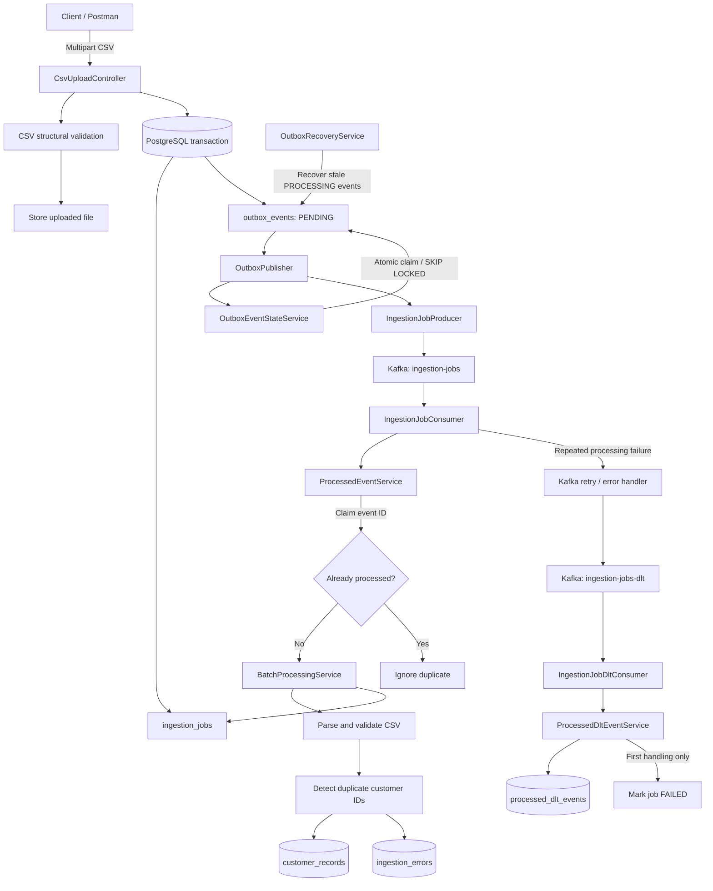

Distributed Data Ingestion & Processing Platform
A distributed CSV ingestion backend built with Java 25, Spring Boot 4,
PostgreSQL, Apache Kafka, and Gradle. The platform accepts CSV
uploads, creates trackable ingestion jobs, validates and processes
customer records in batches, and uses Kafka for asynchronous execution.

The implementation includes a Transactional Outbox, Kafka retry and
Dead Letter Topic (DLT) handling, consumer idempotency, duplicate
customer-ID protection, concurrent outbox claiming, abandoned-event
recovery, retry limits, DLT idempotency, and automated tests.

Project status: Phases 1--5 are implemented. Phase 6 is in progress:
structured logging, Actuator health checks, Kafka health monitoring,
and custom ingestion metrics have been implemented and verified.
Outbox monitoring, observability tests, and final documentation
verification remain in progress.
Contents
1. Overview
2. Architecture
3. End-to-end workflow
4. Reliability and failure
   handling
5. Database model and migrations
6. Codebase structure
7. Technology stack
8. Configuration
9. Run locally
10. API and verification
11. Automated tests
12. Observability and monitoring
13. Implementation status and roadmap
1. Overview
   The platform separates the synchronous upload request from background
   data processing. The API validates and stores the uploaded file, creates
   an ingestion job, and records an event in PostgreSQL. A scheduled
   publisher later sends that event to Kafka, allowing a consumer to
   process the CSV asynchronously.
   Core capabilities
- Multipart CSV upload and file-level structural validation.
- Ingestion job creation and job status tracking.
- Row-level customer validation and error recording.
- Batch persistence to PostgreSQL.
- Asynchronous processing through Apache Kafka.
- Transactional Outbox pattern for reliable event publication.
- Kafka retry handling with exponential backoff and a DLT.
- Idempotent handling of duplicate main-topic events.
- Duplicate customer-ID detection within a CSV.
- Atomic outbox event claiming to reduce concurrent duplicate
  publishing.
- Recovery of outbox events left in PROCESSING.
- Configurable maximum outbox publishing attempts.
- Idempotent DLT event handling.
- Automated unit and API integration tests.
2. Architecture

Component responsibilities
Component                           Responsibility
REST controllers                    Accept uploads and expose
ingestion-job operations

CSV validation and storage          Validate file structure and store
uploaded CSV files

PostgreSQL                          Store jobs, customer records, row
errors, outbox events, and
processed-event markers

Transactional Outbox                Persist the event in the same
transaction as the associated
database operation

Outbox publisher                    Claim pending events and publish
them to Kafka

Kafka producer                      Publish ingestion events using the
job ID as the record key

Main Kafka consumer                 Claim an event ID and invoke
background processing

Batch processor                     Parse, validate, de-duplicate, and
persist records in batches

Processed-event service             Prevent duplicate processing of the
same event ID

Kafka error handler                 Retry failed listener processing
and forward exhausted messages to
the DLT

DLT consumer                        Record DLT handling once and mark
the associated job failed

Outbox recovery service             Return stale PROCESSING events to
PENDING
Outbox state service                Track attempts, errors, and
terminal failure state
3. End-to-end workflow
   3.1 Upload and job creation
1. A client submits a CSV through the multipart upload endpoint.
2. The upload controller coordinates file validation and storage.
3. File-level validation checks the CSV structure and required headers.
4. The application creates an ingestion job.
5. The application creates an outbox event in the same database
   transaction.
6. The API returns the job/upload response without waiting for the CSV
   to be fully processed.
   The multipart CSV upload flow is handled by CsvUploadController.
   IngestionJobController is a separate controller for job-related API
   operations, including metadata-only job functionality and job retrieval.
   Consult the current controller mappings for exact routes and request
   fields.
   3.2 Outbox publication
1. OutboxPublisher periodically looks for pending outbox events.
2. OutboxEventStateService claims a batch of events using a
   PostgreSQL locking query with FOR UPDATE SKIP LOCKED.
3. Claimed events transition to PROCESSING and receive a
   processing-start timestamp.
4. IngestionJobProducer publishes an IngestionJobEvent to
   ingestion-jobs.
5. On successful send, the outbox event becomes PUBLISHED.
6. On failure, the attempt count and error are recorded. The event
   returns to PENDING until the configured retry limit is reached,
   after which it becomes FAILED.
   The Kafka record key is the job ID, so events for the same job are
   consistently routed by Kafka to the same partition.
   3.3 Background processing
1. IngestionJobConsumer receives the event.
2. ProcessedEventService attempts to claim its event ID in
   processed_events.
3. If the event ID has already been claimed, the duplicate delivery is
   ignored.
4. If the event is new, BatchProcessingService claims the job for
   processing.
5. The CSV parser reads the rows and the validator checks customer
   fields.
6. Duplicate customer IDs within the same CSV are detected and recorded
   as DUPLICATE_CUSTOMER_ID errors.
7. Valid records and row-level errors are persisted in batches.
8. The job is finalized with its resulting status and row counters.
   3.4 Row-level validation
   File-level validation and row-level validation serve different purposes:
- File-level validation checks whether the uploaded CSV has the
  expected structure and required headers.
- Row-level validation checks individual customer values after the
  file has been accepted.
  A structurally valid CSV may contain invalid rows. Valid rows can be
  stored while invalid rows are written to ingestion_errors.

Duplicate customer IDs are tracked across the CSV processing run. The
first valid occurrence is retained; subsequent occurrences are recorded
with the error code DUPLICATE_CUSTOMER_ID and are not inserted as
additional customer records. The database uniqueness constraint on
(job_id, customer_id) provides an additional persistence-level
safeguard.
3.5 Job outcomes
The job status reflects the processing result, while the outbox status
reflects event publication. These are separate lifecycles: an outbox
event being PUBLISHED does not mean the ingestion job has completed.
4. Reliability and failure handling
   4.1 Transactional Outbox
   The Transactional Outbox pattern addresses the dual-write problem: the
   application must persist its database change and arrange for an event to
   be published. The job and outbox event are stored in the same database
   transaction. A separate publisher sends the event to Kafka.

This avoids relying on a database write and Kafka publish being
independently successful within one request.
4.2 Main consumer idempotency
ProcessedEventService uses the processed_events table to claim event
IDs. The event ID is the primary key. The insert uses PostgreSQL
ON CONFLICT DO NOTHING so that duplicate deliveries cannot claim the
same event ID a second time.

The consumer processes the job only when the event claim succeeds. After
successful processing, the event is marked COMPLETED. If processing
throws an exception, the in-progress marker is released and the
exception is rethrown so Kafka retry handling can run.
4.3 Concurrent outbox publishing
The outbox claiming query uses PostgreSQL FOR UPDATE SKIP LOCKED and
updates claimed rows to PROCESSING. This prevents concurrent publisher
workers from selecting the same locked rows at the same time.
4.4 Abandoned outbox recovery
A process may stop after claiming an outbox event but before completing
publication. OutboxRecoveryService periodically finds events that have
remained in PROCESSING longer than the configured timeout and returns
them to PENDING, clearing the processing timestamp.
4.5 Outbox retry limits
The outbox tracks the number of publishing failures and the most recent
error. The configured maximum attempt count determines when an event
transitions from PENDING to terminal FAILED status.

This is separate from the Kafka listener retry policy: outbox retries
concern publishing an event to Kafka, while Kafka listener retries
concern processing a message after it has been consumed.
4.6 Kafka retry and DLT handling
The main listener is configured with Spring Kafka error handling and
exponential backoff. When listener processing continues to fail after
the retry policy is exhausted, the event is routed to
ingestion-jobs-dlt.

ProcessedDltEventService inserts the event ID into
processed_dlt_events using ON CONFLICT DO NOTHING. Only the first
successful insert triggers the job failure operation. Duplicate DLT
deliveries are ignored.
4.7 Important delivery semantics
The system uses retry and idempotency mechanisms because asynchronous
messaging can deliver a message more than once. Idempotency guards
reduce duplicate database effects, but they do not by themselves make
every part of a distributed workflow exactly-once. Database
transactions, Kafka acknowledgement behavior, and recovery paths must be
considered together.
5. Database model and migrations
   Flyway manages database schema changes. The migrations currently present
   in the project are:
   Migration                                                Purpose
   V1__create_ingestion_jobs.sql                          Create ingestion job metadata

V2__allow_metadata_only_jobs.sql                       Allow metadata-only jobs

V3__create_customer_records_and_ingestion_errors.sql   Create customer record and
row-error tables

V4__create_outbox_events.sql                           Create the transactional outbox
table

V5__align_outbox_events_schema.sql                     Align the outbox schema

V6__create_processed_events.sql                        Create main consumer idempotency
tracking

V7__add_outbox_processing_timestamp.sql                Add processing timestamp for
abandoned-event recovery
V8__create_processed_dlt_events.sql                    Create DLT idempotency tracking
Main tables
Table                               Purpose
ingestion_jobs                    Job metadata, status, row counters,
and file information

customer_records                  Successfully validated customer
records

ingestion_errors                  Row-level validation and
duplicate-record errors

outbox_events                     Events waiting to be published,
currently being published,
published, or failed

processed_events                  Main Kafka event IDs and their
processing status
processed_dlt_events              DLT event IDs already handled
Outbox lifecycle
Status         Meaning
PENDING      Ready to be claimed for publishing
PROCESSING   Claimed by a publisher
PUBLISHED    Kafka accepted the event
FAILED       Maximum configured publishing attempts reached

The outbox also tracks fields such as attempts, last_error,
published_at, and processing_started_at.
Processed-event lifecycle
processed_events tracks the main event ID, associated job ID, status,
receive time, and completion time. The statuses used by the
implementation are IN_PROGRESS and COMPLETED.

processed_dlt_events records each DLT event ID and associated job ID
so that a repeated DLT delivery does not repeat the failure operation.
6. Codebase structure
   The main application package is:

com.surya.DistributedDataPlatform
src/main/java/com/surya/DistributedDataPlatform/
├── common/
│   └── exception/
├── config/
│   ├── KafkaConsumerConfig.java
│   └── KafkaProducerConfig.java
├── jobs/
│   ├── controller/
│   ├── dto/
│   ├── entity/
│   ├── repository/
│   └── service/
├── messaging/
│   ├── consumer/
│   │   ├── IngestionJobConsumer.java
│   │   ├── IngestionJobDltConsumer.java
│   │   ├── ProcessedEventService.java
│   │   └── ProcessedDltEventService.java
│   ├── error/
│   │   └── KafkaErrorHandlerConfig.java
│   ├── event/
│   │   └── IngestionJobEvent.java
│   ├── producer/
│   │   └── IngestionJobProducer.java
│   └── outbox/
│       ├── entity/
│       │   ├── OutboxEvent.java
│       │   └── OutboxStatus.java
│       ├── repository/
│       │   └── OutboxEventRepository.java
│       └── service/
│           ├── OutboxService.java
│           ├── OutboxEventStateService.java
│           ├── OutboxPublisher.java
│           └── OutboxRecoveryService.java
└── processing/
├── parser/
│   └── CsvRecordParser.java
├── service/
│   ├── BatchProcessingService.java
│   └── BatchPersistenceService.java
└── validator/
└── CustomerRecordValidator.java

src/main/resources/
├── application.properties
└── db/migration/
├── V1__create_ingestion_jobs.sql
├── V2__allow_metadata_only_jobs.sql
├── V3__create_customer_records_and_ingestion_errors.sql
├── V4__create_outbox_events.sql
├── V5__align_outbox_events_schema.sql
├── V6__create_processed_events.sql
├── V7__add_outbox_processing_timestamp.sql
└── V8__create_processed_dlt_events.sql

src/test/java/
└── com/surya/DistributedDataPlatform/
├── DistributedDataPlatformApplicationTests.java
├── IngestionJobApiIntegrationTests.java
├── messaging/
│   ├── consumer/
│   └── outbox/
└── processing/
├── service/
└── validator/
The package tree above highlights the principal components; consult the
source tree for the complete set of DTOs, entities, repositories,
controllers, and exception classes.
7. Technology stack
   Technology                          Usage
   Java 25                             Application language and runtime

Spring Boot 4.0.9                   Application framework

Spring Web MVC                      REST and multipart upload endpoints

Spring Data JPA / Hibernate         Persistence and ORM

Spring Kafka                        Kafka producer and listener
integration

Apache Kafka 4.1.x                  Asynchronous event transport

PostgreSQL 17                       Relational persistence

Flyway                              Database schema migrations

Apache Commons CSV                  CSV parsing

Gradle                              Build and dependency management

Docker Desktop / Docker Compose     Local PostgreSQL and Kafka
infrastructure

JUnit 5 / Mockito                   Automated testing
Testcontainers                      Container-based test dependencies
available in the build
8. Configuration
   The following are the key local-development properties. Refer to
   src/main/resources/application.properties for the complete
   configuration.
   spring.application.name=distributed-data-platform

spring.datasource.url=jdbc:postgresql://localhost:5432/dataplatform
spring.datasource.username=dataplatform
spring.datasource.password=${DB_PASSWORD:devpassword}
spring.datasource.driver-class-name=org.postgresql.Driver

spring.jpa.hibernate.ddl-auto=none
spring.jpa.open-in-view=false

spring.servlet.multipart.max-file-size=10MB
spring.servlet.multipart.max-request-size=11MB
app.upload-dir=./uploads

app.processing.batch-size=500
app.processing.poll-delay-ms=2000

spring.kafka.bootstrap-servers=localhost:9092
spring.kafka.consumer.group-id=ingestion-worker-group
spring.kafka.consumer.auto-offset-reset=earliest
spring.kafka.consumer.enable-auto-commit=false

app.kafka.topic.ingestion-jobs=ingestion-jobs
app.kafka.topic.ingestion-jobs-dlt=ingestion-jobs-dlt
app.kafka.test-fail-enabled=false

app.outbox.batch-size=50
app.outbox.poll-interval-ms=2000
app.outbox.recovery-timeout-seconds=60
app.outbox.recovery-interval-ms=30000
app.outbox.max-attempts=3
Local infrastructure
The local Docker Compose setup uses:

Service      Container                  Port
PostgreSQL   ingestion-postgres     5432
Kafka        ingestion-kafka        9092

Local PostgreSQL defaults in the development Compose configuration:
- Database: dataplatform
- Username: dataplatform
- Password: devpassword
  These are local development values only. Use environment variables or a
  secret manager for non-local environments. Do not commit production
  credentials.

The app.kafka.test-fail-enabled property is a deliberate test hook for
exercising the consumer failure/DLT path. Keep it false during normal
processing.
9. Run locally
   Prerequisites
- Java 25
- Docker Desktop
- Git
  Start infrastructure
  From the project root:
  docker compose config
  docker compose up -d
  docker compose ps
  Confirm the PostgreSQL and Kafka containers are running.
  Start the Spring Boot application
  .\gradlew.bat bootRun
  The application is configured to connect to PostgreSQL at
  localhost:5432 and Kafka at localhost:9092.
  Run automated tests
  .\gradlew.bat clean test
  Open the Gradle test report on Windows:
  Start-Process .\build\reports\tests\test\index.html
10. API and verification
    The project exposes ingestion-job and CSV upload APIs. For exact
    endpoint paths, HTTP methods, multipart part names, request fields, and
    response DTOs, use the current controller classes as the source of
    truth:
- CsvUploadController
- IngestionJobController
  Do not assume routes or request field names from this overview; they can
  evolve with the API implementation.
  Useful PostgreSQL checks
  Recent ingestion jobs:
  SELECT
  id,
  status,
  total_rows,
  processed_rows,
  failed_rows,
  completed_at
  FROM ingestion_jobs
  ORDER BY created_at DESC
  LIMIT 10;
  Outbox events:
  SELECT
  id,
  job_id,
  event_type,
  status,
  attempts,
  last_error,
  processing_started_at,
  published_at
  FROM outbox_events
  ORDER BY created_at DESC
  LIMIT 10;
  Main consumer idempotency:
  SELECT
  event_id,
  job_id,
  status,
  received_at,
  completed_at
  FROM processed_events
  ORDER BY received_at DESC
  LIMIT 10;
  DLT idempotency:
  SELECT
  event_id,
  job_id,
  handled_at
  FROM processed_dlt_events
  ORDER BY handled_at DESC
  LIMIT 10;
  Customer records:
  SELECT *
  FROM customer_records
  ORDER BY created_at DESC
  LIMIT 10;
  Row-level errors:
  SELECT *
  FROM ingestion_errors
  LIMIT 10;
11. Automated tests
    The latest reported full test run used:
    .\gradlew.bat clean test
    Reported result: 26 tests, 0 failures, 0 skipped (100% successful).
    Test class                                  Coverage                                Test count
    DistributedDataPlatformApplicationTests   Application context                              1

IngestionJobApiIntegrationTests           API integration                                  8
scenarios

IngestionJobConsumerTest                  Duplicate main-topic                             1
event handling

ProcessedDltEventServiceTest              First-time and                                   2
duplicate DLT
handling

OutboxEventTest                           Outbox state and                                 6
retry behavior

OutboxRecoveryServiceTest                 Recovery service                                 2
update behavior

BatchProcessingServiceTest                Duplicate customer                               2
IDs and job-claim
behavior

CustomerRecordValidatorTest               Customer field                                   4
validation            
Total                                                                               26
The report is from the test run shared during development. Re-run the
suite against the current branch before merging subsequent changes.

The outbox recovery unit test verifies the recovery update is invoked
with the configured timeout. It is not, by itself, a PostgreSQL
integration test of the full recovery lifecycle. Similarly, focused unit
tests do not replace end-to-end tests against real Kafka and PostgreSQL
infrastructure.
Manually verified Phase 5 scenarios
The following behaviors were exercised during development:
- Duplicate delivery of the same main event did not create a second
  processed-event marker or repeat the job processing.
- A CSV containing a repeated customer ID retained the first valid
  record and recorded the duplicate as a row error.
- Outbox claiming moved events into PROCESSING; successfully
  published events moved to PUBLISHED.
- An artificially aged PROCESSING event was recovered to PENDING
  and then published after the application restarted.
- With Kafka stopped, an outbox event reached FAILED after the
  configured three publishing attempts.
- With the temporary consumer failure switch enabled, a new event
  exhausted listener retries, reached the DLT, and its job was marked
  FAILED.
- DLT event handling was recorded in processed_dlt_events.
  These are development verification scenarios, not a claim of
  production-scale load or fault-injection testing.
13. Implementation status and roadmap
    Phase                   Scope                   Status
    Phase 1                 Job metadata API        Complete

    Phase 2                 CSV upload and          Complete
    structural validation

    Phase 3                 Asynchronous batch      Complete
    processing

    Phase 4                 Kafka integration,      Complete
    Transactional Outbox,
    retries, and DLT

    Phase 5                 Idempotency, duplicate  Complete
    protection,
    concurrency, recovery,
    retry limits, DLT
    idempotency, automated
    tests

    Phase 6                 Testing and             In progress
    observability

    Phase 7                 Docker, CI, and         Planned
    deployment

    Phase 8                 Final project           Planned
    documentation and
    operational guides

12. Observability and monitoring

    12.1 Structured logging
- Console application logs use Logstash-compatible structured JSON.
- Application log levels are configured for INFO by default.
- Request logging is implemented through RequestLoggingFilter.
- Job processing logs include job correlation information through MDC.
- Kafka consumer logs include job and event identifiers where available.
- Batch processing logs report batch number, records read, valid records,
  rejected records, and elapsed processing time.
- Outbox publisher logs report publishing lifecycle activity.

  12.2 Health monitoring
  Spring Boot Actuator exposes application health information.

| Endpoint | Purpose |
|---|---|
| `/actuator/health` | Overall application health |
| `/actuator/health/db` | PostgreSQL health |
| `/actuator/health/kafka` | Custom Kafka broker connectivity check |
| `/actuator/health/liveness` | Application liveness |
| `/actuator/health/readiness` | Application readiness |

Health details and components are enabled in the local configuration.
The custom KafkaHealthIndicator checks broker connectivity and reports
broker information when available. It reports DOWN when Kafka cannot
be reached. Both Kafka UP and DOWN behavior were manually verified.

    12.3 Custom application metrics
Micrometer metrics are exposed through Spring Boot Actuator.

| Metric | Description |
|---|---|
| `ingestion.jobs.created` | Number of ingestion jobs created |
| `ingestion.jobs.completed` | Number of jobs whose processing completed, including COMPLETED_WITH_ERRORS |
| `ingestion.jobs.failed` | Number of jobs marked failed through DLT handling |
| `ingestion.records.processed` | Number of valid records persisted |
| `ingestion.records.rejected` | Number of rejected records persisted |
| `ingestion.job.duration` | Ingestion job processing duration |

The custom metrics are available through `/actuator/metrics` after
their corresponding application events have occurred. The
`ingestion.jobs.created` metric was verified at runtime and returned
a count of 1.0 after a job was created. Unit tests use
SimpleMeterRegistry to verify DLT failure metric behavior and ensure
duplicate DLT events do not increment the failure counter.

    12.4 Remaining observability work
The following Phase 6 items are still to be implemented and verified:
- Database-backed gauges for PENDING, PROCESSING, FAILED, and PUBLISHED
  outbox event counts.
- Tests for outbox monitoring metrics and any additional observability
  behavior.
- Final README review and full application verification after all
  Phase 6 changes are complete.

13. Implementation notes and roadmap
    Phase 7 --- Docker, CI, and deployment
    Planned focus:
- Production-oriented Docker image and configuration.
- CI workflow for build and automated tests.
- Environment-specific configuration and secret handling.
- Deployment and runtime documentation.

Repository
GitHub: https://github.com/codewithsurya27/distributed-data-platform

The source code and Flyway migrations are the final source of truth for
exact endpoint mappings, entity fields, and implementation details.
This README summarizes the architecture and the Phase 1--5
implementation, together with the Phase 6 observability work completed
so far.